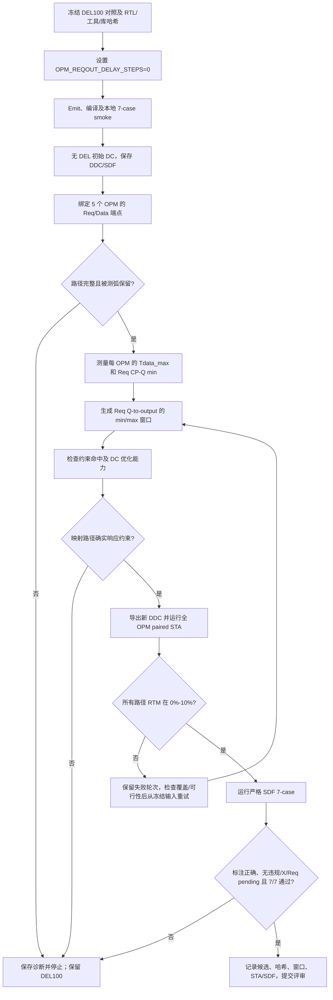

# CMR 半自动综合与配对 STA 流程

> OPM 最终综合优化结果（2026-10-10）：见
> `scripts/asic_dc/cmr/results/20261010_opm_extreme_final_r1/summary.md`。

本文是后续开发者/agent 的操作 runbook。流程原则可复用到不同 CMR 配置；本文列出的自动化脚本和层次名目前是 **RouterL1 示例**，不可未经核对直接套用到其他 DUT。

## 流程总览

### 2026-10-03 写侧保护试验进度（不是全网签核）

冻结输入仍为 `20261002_200000_prop_m16_opm_outputrestore_tailbuf1_eco_r13`，TT/0.8 V/25℃。只在独立分析副本插入保护，不改 DUT RTL、状态语义或生产 SDC。

- r46 的固定 Tail Mux 名称绑定失败；r47 改为沿 `io_Tail_slot` 实际连接寻找选择引脚，并核对 Storage bit26 来源。禁止把某实例的 U 编号套用至其他实例。
- `20261003_153000_prop_m16_write_storage_bound_tail_r47`：两个重点下游写接口、五槽、两个请求相位、28 位及两个数据边沿，共 1,120 配对；870 组负裕量，最差 −37.037 ps。Tail 位筛查最差 −0.731 ps。
- `20261003_160000_prop_m16_cellfull_del050_trial_r48`（远程 job 13109001）：分析副本的 CellFull 输出及非 Tail Ack 选择输入增加 DEL050；原始 CellFull 的状态反馈和空槽比较保留。100 次插入连接检查通过，1,120 配对负裕量为 0，最差 +12.285 ps；1,120 组均超过 RTM 10%，20 个共享附加延迟窗口均为空。停止该位置的盲目 10% 延迟扫描，安全目标另行验证。
- 结果入口：`scripts/asic_dc/cmr/results/<run ID>/write_storage_paired_audit.json`、`write_storage_pairs.csv`、`completion_audit.json` 与逐路径报告；审计命令 `python scripts/asic_dc/cmr/audit_m16_write_storage.py <result-directory>`。

上述结论仅为输入 request slew 2 ps、恢复标量边界负载的条件性 Storage/CellFull RTC，不证明真实输入预算、读 Mux 消费路径、完整 Tail 转换、setup/hold/脉宽/reset 或全实例安全。r48 原始 manifest 未单列 trial 参数，保留原文件；DEL050 及原始反馈证明以该轮 Tcl 和日志为准。后续 launcher 显式记录保护参数。`CMR_WRITE_ANALYSIS_REQUEST_SLEW_NS` 用于独立敏感性试验，不能把任一选定值冒充生产边界预算。

下一步先复测边界转换时间敏感性，再补连续 Storage→读 Mux 与 CellFull→ReqLatch→实际消费端配对，以及 Tail 四组合及关闭/复用检查；有效后才向完整映射候选推广保护。当前没有宣布完整 RouterL1/L2/L3 闭合。

### r49–r52：读侧真实绑定与条件性边界传递

- r49 `20261003_163000_prop_m16_cellfull_del050_slew045_r49`，job 13109101：DEL050 分析副本、request slew 45 ps，1,120 组写侧配对无负裕量，最差 +12.254 ps，仍全部超过 RTM 10%。只有 2/45 ps 两个敏感性点，不能据此声称连续 slew 范围或真实生产预算已验证。该轮实际 slew 见 `write_ack_profiles.tsv`；launcher 后续已补 manifest 的独立 request slew 字段。
- r50 绑定失败于已裁剪的 `ReadInterface.io_ReadPointer` 调试输出。r51 `20261003_173000_prop_m16_read_active_enable_bindings_r51`（job 13109301）改用实际 `ControlUnit.ReadPointer` 与 ReqLatch.E 的共同驱动检查，完整覆盖 48 个 Router、1,536 个读接口、7,680 个 ReadControlUnit、15,360 个 Req/CellEmpty latch、215,040 条 Storage 位连接，以及 44,544 个 Req/Data 输出边界。`read_binding_audit.json` 明确 `timing_checked_states=0`，不能将端点绑定数当作时序覆盖率。
- 实际连接中，1,344 条分支直接进入 OPM，请求及全部数据位的 OPM 目的集合一致；另 192 条请求先进入 lane adapter，数据直接分发至对应 OPM。后者需独立追踪 adapter 内状态及请求传播，禁止把原始 IPM Reqout 当作 OPM 已收到的 Req。逐分支结果保存在 `branch_mappings`，没有使用端口编号公式替代真实连接。
- r52 `20261003_180000_prop_m16_read_selected_transfer_r52`（job 13109401）：两个重点下游 IPM7/branch3、五槽、两个相位、全部数据位/边沿，共 1,120 配对。由 r49 的实际边界边沿及 slew 传入 ReadInterface 分析副本；Req 连续测 CellFull→ReqLatch.D→Q→Reqout，数据连续测对应槽 Datain→读 Mux→Dataout。保留实际映射、恢复外部标量负载；源视图加载前后连接图一致不等于 CCS 接收器环境等价。无自动禁弧/报告错误；原始证据、输入 SHA、节点/边沿/slew、实际导出 SDC 的指针、latch 使能、旧相位及取消状态检查通过。条件性配对均非负，最差 +77.848 ps，全部超过 RTM 10%。

新增入口（仍不是通用或全场景签核入口）：`CMR_PROP_M16_STA_MODE=read_bindings` 用于 M16 全目录；`read_selected` 仅支持 `TARGETS=focus`，以 `CMR_READ_WRITE_PROFILE_RUN_ID` 选择已审计的 Write/Storage 上游报告，且 DDC/post/SDF 哈希必须一致。运行器仍为 `scripts/asic_dc/cmr/run_remote_cmr_prop_m16_opm_tail_sta.py`；结果复核使用 `audit_m16_read_bindings.py`、`prepare_m16_read_profiles.py`、`audit_m16_read_selected.py`。

r52 的条件包括指针已稳定、正确单播、无取消、Ack 尚未返回且未释放槽位。它不检查读指针推进的 E→Q、关闭 setup/hold、Ack 释放/重用、Tail 四组合、取消/多播或 reset/pulse。此外上游 DEL050 仅存在于试验副本，冻结 r13 未被修改。先用无 CellFull DEL 的上游 r47 重测相同读侧场景，判断原始消费端是否真的需要该保护；Storage/CellFull 原始边界负裕量本身不能替代真实消费端 RTC 或作为盲目插入 DEL 的依据。非 Tail Ack/Tail 选择的保护必要性仍须单独查明。

方法补充：r52/r53 的首个 Req 查询发生在所有数据窗口安装完成前，虽然端点/边沿/导出场景审计通过，仍不能证明所有报告与最终 SDC 处于同一完整约束状态。因此保留数值，但统一降为 `measurement_valid=false`、`MEASUREMENT_AUDIT_PENDING`。新入口在首次查询前安装所有源 slew、输入延迟、窗口及场景条件，先保存 SDC，之后只查询、不改变约束；每场景输出 `CMR_READ_QUERY_STATE ... constraints=FROZEN_BEFORE_FIRST_QUERY`。缺少全部 20 个场景记录不得算测量通过。

`CMR_READ_QUERY_ORDER=normal/reverse` 对同一冻结源进行 57 个查询的正反顺序复核。`audit_m16_read_query_order.py <normal-result> <reverse-result>` 要求 DDC/post/SDF、上游输入字节、1,120 个配对及 1,140 份路径目录完全匹配；实际节点、库引用和极性一致，slew、增量和到达差不超过 `1e-6 ns`。仅生成 PASS 标记或非负数值不足以通过。r54 `20261003_190000_prop_m16_read_frozen_query_normal_r54`（13109601）与 r55 `20261003_190100_prop_m16_read_frozen_query_reverse_r55`（13109701）已经完成：正反查询差异为 0，全部条件性配对非负，最差 +25.375 ps，全部超过 RTM 10%。上游使用无 CellFull DEL 的 r47；不能仅因原始 Storage/CellFull 边界负裕量而采用试验 DEL050。该结果仍不覆盖指针推进、关闭/释放、Tail 与外部预算。

### r56：真实读输出到 OPM 首次捕获

入口 `CMR_PROP_M16_STA_MODE=opm_input`、`TARGETS=focus`，使用 r54 的实际 Req-min/Data-max 到达及输出 slew、r51 的实际消费者绑定，以及 r55 的查询顺序审计。`prepare_m16_opm_capture_profiles.py` 冻结输入和源报告 SHA。不是任意实例通用入口。

r56 `20261003_200000_prop_m16_opm_input_native_fire_r56`（13109801）覆盖 L2(0,3)/OPM3 与 L1(q0,i2)/OPM3 的来源 6、五槽、两个请求相位及 28 位两个边沿：1,120 个 setup 检查，无负裕量，最差 +362.282452 ps。测量沿真实 `Reqin → ReqSelection latch D/Q → RegEnable → DataReg.CP` 传播，不直接标注 Fire 或 CP；Data 沿真实选择网络至 DataReg.D。28 个 CP 的共同网络及转换时间逐项核对，已测条件下 CP slew 为 141.313–141.730 ps。

`audit_m16_opm_input_capture.py <result-directory> <data_ff_library_tables.json>` 验证源哈希、端点不延伸、实际 Grant 驱动的单热场景与导出 SDC 一致、边沿/slew 连续、目录完整及真实库 setup 表。库表例子位于 `scripts/asic_dc/cmr/results/20261003_043000_prop_m16_firebuf4_all_r25/data_ff_library_tables.json`。最差配对的库 setup 为 −4.273452 ps；这是相应 D/CP slew 的真实负 setup 要求，不应改成固定 13 ps。

此场景假设 Grant 已稳定、Ack 已准备、正确单播、尚未 self-close；固定旧 raw Req 状态只用于首次捕获，不能据此测自关闭脉宽或 TailPassed。尚未覆盖 Grant 开启、Ack-ready 触发、hold/reset、全部来源、完整 CCS 边界等价和输出 RTC。Req-min 路径得出的 CP slew 不是全场景最大时钟转换时间预算，不能直接用于宣称输出 RTC 闭合。L3 原 Tail 违规实例也不在本轮两个输入消费者内。

`CMR_READ_QUERY_ORDER` 同时控制 `opm_input` 查询顺序；`audit_m16_opm_capture_order.py <normal-result> <reverse-result> <library-tables>` 比较 1,680 份路径、1,120 个 setup 配对，容差仍为 `1e-6 ns`。r57 启动前因工艺 Tcl 哈希检查失败、未提交 DC 作业：现有上传器转换 CRLF→LF，远程实际 LF 字节与本地规范化字节相同。修正检查为上传字节 SHA，而不是绕过真实差异；r58 `20261003_204500_prop_m16_opm_native_reverse_r58`（13109901）已完成，正反查询全部路径/配对差异为 0，setup 最差仍为 +362.282452 ps，作业前后工艺 Tcl/db/lib 哈希完全一致。结果为 `opm_input_setup_audit.json` 与 `opm_input_query_order_audit.json`；仍限定条件性首次捕获，不是完整 OPM/Router 闭合。

后续 `opm_input` 在作业前后保存实际工艺 Tcl、TT `.db` 与 `.lib` 的 SHA，三项必须完整且前后相同。原始 Windows 文件 SHA 与上传 LF 字节 SHA 属不同表示，必须区分。r56 没有当时的前后库快照，不能补写为已冻结；其 Liberty 表 SHA 与报告角点已核对。当前实时库 SHA：`.db` 为 `64bc0405b7f40f7887c40450a9f8b6fd605f7690ddbd99c136287dda099c759a`，`.lib` 为 `55954aaaa805caed00c8b664f6a32eacef9be0428adcb6e72cc7cf7a272431ca`。

下一轮顺序：先完成上述反向路径复核，再建立“下一槽已有数据、读指针推进”的独立场景，比较同一完成事件下旧/新 ReadPointer 边沿对数据 Mux 和 ReqLatch.E→Q 的影响；不能继承已选槽场景的固定指针 cut。随后检查 Ack 关闭/槽位复用、Tail 四组合与取消/多播。OPM 的 Grant-opening、Ack-ready 与 self-close 必须分别恢复真实反馈并测量，输入首捕获的旧 raw Req case 不可带入这些场景。仅在这些检查确认缺口和合法保护窗口后增加 DEL/buffer；当前不能将试验 CellFull DEL050 或共享 Fire buffer 当作已采用的修复。推广至全部 L1/L2/L3 实例前，还须证明源最大/最小转换时间预算、完整边界环境及当前源码对应冻结候选。

### r59：指针推进场景的连接预检

`CMR_PROP_M16_STA_MODE=read_pointer` 仅支持 `TARGETS=focus`，运行 `probe_sta_cmr_m16_read_pointer.tcl`。r59 `20261003_211500_prop_m16_read_pointer_preflight_r59`（13110001）完成，`audit_m16_read_pointer.py <result-directory>` 核对冻结三产物 SHA、两个真实读接口、10 个指针状态、环形移位 D←前一槽 Q、Q→对应 ReqLatch.E 和共同 CP 驱动。结果 `read_pointer_binding_audit.json` 为连接有效，但明确 `timing_checked_states=0`。

实际完成事件来自 `~(ReqX ^ AckX)`，两重点实例均映射到 XNR2D0。请求反馈与 Ack 完成分别进入该单元，断环时须沿实际连接识别角色，不硬编码引脚名称。保持 Ack 完成→Counter.CP→旧 Q↓/新 Q↑、数据 Mux 以及新 ReqLatch.E→Q 路径；请求→Counter.CP 的反馈可按场景审查，不能把相关 cut 用于自关闭/脉宽检查。槽 0 实际为 `DFSNQD1`（异步置位）；槽 1–4 为 `DFCNQOPTMAD8`（异步清零）。Req latch 则按槽初始相位使用 `LHCNDQD1/LHSNDQD1`，不可套同一复位库弧。

下一测量需要同时区分旧指针下降和新指针上升，覆盖五个转换（含 4→0 回绕）、两个请求相位、数据 rise/fall；已有下一槽数据应在推进前稳定。必须证明触发事件、源 slew、ReqLatch 开启与旧 latch 关闭的关系；只将单热指针全部固定不能完成此场景。当前未插入任何新保护，未宣称读推进通过。后续 launcher 在上传前捕获 Tcl 字节，manifest 分别保存原始来源 SHA 和实际 LF 上传 SHA，避免长任务运行期间读取已被修改的本地文件作为原运行的脚本哈希；r59 历史 manifest 保留不补写。

### r60/r61：回绕路径方法试验

新增 `CMR_PROP_M16_STA_MODE=read_advance`，当前仅两个重点实例、4→0 回绕、两个请求相位、28 位 rise/fall。`CMR_READ_ACK_SOURCE_SLEW_NS` 明确是 AckX 状态 Q 的条件性分析输入，默认 2 ps，不是实际生产预算。

r60 `20261003_214500_prop_m16_read_wrap_pilot_r60`（13110101）在首次 AckX→请求连续查询返回 no-path，保留失败，不能计作安全通过。修正方法不把相邻 Q 直接接入的 Counter.D 常量化；用真实旋转连接和旧 Q↓/新 Q↑ 的查询边沿限定事务。r61 `20261003_221000_prop_m16_read_wrap_cp_replay_r61`（13110201）完成源时钟路径提取，但 CP→Q→请求仍 no-path，测量无效。第一场景实际 AckX→两个 CP 均为 56.339 ps，CP slew 62.366 ps（源条件 2 ps）；这是有效片段，不是完整 RTC。

独立 CP 重放方法先保存源场景，分别测 AckX→槽 0/4 CP 的 min/max 路径及实际 slew；独立副本恢复相同场景后将这些 slew 传入 CP，再冻结全部下游窗口后查询 CP→Q→Dataout/Reqout。源/重放场景、节点、边沿、首尾端点、CP 偏斜和 slew 由 `audit_m16_read_advance.py` 核对。DC 对内部起点 Q 可能打印 zero-Gamma launch stub；不得将它当作真实零转换时间，必须核对同网首次实际门输入的 GPIO、边沿和到达时间，且明确只允许起点 stub 为零。

r62 `20261003_223500_prop_m16_read_wrap_arc_diagnostic_r62`（13110301）完成诊断后仍按完整查询 no-path 失败。首场景的 CP→新指针 Q→ReqLatch.E 与 ReqLatch.E→Q→请求两条路径均存在，连接处 slew 都为 54.133 ps；该场景 28 条 CP→指针→数据路径也均提取。直接跨 latch 时钟端的查询没有返回路径，不能用零延迟补齐或据此判断 RTL 错误。此结果支持进一步验证按真实 E↑ 连接的分段模型，不代表 RTC 验收。

r63 `20261003_230000_prop_m16_read_wrap_latch_boundary_r63`（13110401）完成明确分段版本：请求总到达为 AckX→槽 0 CP min + CP→Q→ReqLatch.E min + E↑→Q→Reqout min；数据为 AckX→对应 CP max + CP→对应指针 Q→Dataout max。在首次下游查询前同时安装两个请求段及全部数据窗口；连接 E 的边沿和 slew 必须匹配 `1e-6 ns`，来源/重放场景一致，每个路径实际首尾端点必须准确。两请求段都有实际路径及正确边沿时才可形成有效配对，并且必须保留其库参考、负载和 slew 证据。没有强行建 generated clock。

当前 224 个条件性配对通过目录、场景、端点、边沿、slew 连续及 cut 审计；负裕量 0，全部 RTM 超过 10%。最差 L2(0,3)/IPM7/branch3，Req↓、Data↑、bit0：Data max 175.571 ps、Req min 243.753 ps、裕量 +68.182 ps，RTM 38.8344%；数据/请求 CP max/min 计入 0.203 ps 到达差。所有源/重放时钟 slew 使用各自实际 min/max，没有以 min 值代替 max。报告/自动禁弧为 0，工艺 Tcl/db/lib 前后 SHA 一致。

结果为 `read_advance_paired_audit.json` 与 `read_advance_pairs.csv`。cut 审计从 r59 的实际 CP/AckX 驱动和反馈连接报告确定门及引脚角色，不把 U 编号直接套到其他实例。`cmr_read_phase_model.py` 的三项回归验证两轮实际五槽翻转，覆盖全部槽/相位 checkpoint；这只是场景可达性检查，不是协议或 RTL 仿真。当前查询顺序复核尚未完成，源 2 ps 非生产预算，CCS 边界等价、其余四个转换、latch 关闭/hold/pulse、Ack 复用及全实例仍未覆盖。因此不新增保护，不宣布读接口或 Router 闭合。下一轮先反向查询复核，再扩展全部五个转换。

r64 `20261003_233000_prop_m16_read_wrap_reverse_r64`（13110601）完成反向复核：`audit_m16_read_advance_order.py <normal-result> <reverse-result>` 比较 r63/r64 的 272 份实际路径和 224 个配对，节点/引用/边沿相同，最大数值差异 0，容差 `1e-6 ns`。覆盖源时钟 min/max 查询和下游全部请求/数据查询反序，所有窗口仍在首次相应查询前安装。独立结果见 r64 的 `read_advance_query_order_audit.json`；不改写原历史运行的查询顺序状态。

新增 `CMR_READ_ADVANCE_SLOTS=0/1/2/3/4/all`（默认 4 保持历史回绕入口）。`all` 对两个重点接口测全部五个转换，预期 1,120 配对、1,360 份路径；按实际旧/新指针生成各场景，ReqLatch 初始相位和对应 DFF 库参考独立审计。该环境变量不影响 RTL 或 DUT 配置。

r65 `20261004_000500_prop_m16_read_all_transitions_r65`（13110701）完成：1,120 个条件性配对负裕量 0，全部 RTM 超过 10%；最差 L2(0,3)/IPM7/branch3、0→1、Req↓、Data↓、bit0，Data max 195.289 ps，Req min 259.946 ps，裕量 +64.657 ps，RTM 33.1084%。该结果确认不能只测 4→0 后沿用其最差数值（原回绕最差 +68.182 ps）。实际初始相位、每个转换的旧/新指针边沿、两段 latch 使能路径 slew、库参考与 80 条 cut 目录均通过当前审计。所有路径无自动禁弧或报告错误，库/工艺 SHA 前后一致。

结果位于 r65 的 `read_advance_paired_audit.json`、`read_advance_pairs.csv`。r64 的反向复核仅覆盖回绕，不能冒充 r65 全五个转换的查询顺序审计。源仍为条件性 2 ps，完整 CCS 边界等价、真实事件预算、latch 关闭/setup/hold/pulse、Ack 释放/槽位复用及其他实例尚未覆盖。当前不新增 DEL，不宣布完整 ReadInterface 或 Router 闭合。

r66 `20261004_003500_prop_m16_read_all_reverse_r66`（13111001）完成全五个转换的反向查询复核。与 r65 比较 1,360 份实际路径、1,120 个配对，绑定、节点、边沿和数值一致，最大差异 0；独立证据为 r66 的 `read_advance_query_order_audit.json`。这是条件性测量的可重复性通过，不是完整 ReadInterface 签核。

后续库检查必须按实际单元和关闭边沿建模。r66 的 `latch_zero_library_tables.json` 从同一 TT Liberty 提取 `LHCNDQD1BWP12T30P140`：D 相对 E 的检查为 `setup_falling` / `hold_falling`，CDN 相对 E 为 `recovery_falling` / `removal_falling`，另有 E/CDN 最小脉宽检查。`inspect_cmr_tail_library.py --cell <实际单元> --output <独立证据文件>` 支持当前置位/复位 latch 及指针 DFF；给定 D/E slew 时查实际 falling 表，不套用 DFF rising 表。表发现或插值本身不构成时序通过，缺少关闭、后续数据或 reset 事件预算时必须保持未覆盖。不得用本次 Data/Req 正裕量代替这些库检查。

r66 的 `latch_one_library_tables.json` 已回收置位型 `LHSNDQD1BWP12T30P140` 表；D/E 仍为 falling 检查，异步输入改为 SDN，recovery/removal 条件为 `!D`，不可套用复位型 CDN 的 `D` 条件。两份表的 Liberty SHA 一致。

读指针 hold 路径提取轮 r67 `20261004_011500_prop_m16_counter_hold_paths_r67`：在原独立 CP 重放场景中额外查询旧槽 Q↓→下一槽 D↓、新槽 Q↑→后继槽 D↑，先从实际 driver 验证环形连接。所有新增 min 窗口在首个下游查询前安装，SDC 与报告在同一状态保存。该轮启动时尚无测量结论；提取成功也只提供数据变化路径。完整 hold 必须合并同一完成事件的源 CP min、目的 CP max/偏斜、实际 D/CP slew 和对应单元库 hold 要求；其他 latch setup/hold、脉宽与 reset 检查不由此代替。

r67（13111201）已完成，`audit_m16_counter_hold_paths.py <result>` 核对 16 条数据变化路径的实际端点、边沿、CP slew 与已冻结场景；路径提取有效，hold 尚未判定。

r68 `20261004_014500_prop_m16_counter_hold_capture_r68`（13111301）补齐后继槽实际 CP max 查询。使用 `audit_m16_counter_hold_paths.py <result> --library <counter_preset_library_tables.json> --library <counter_clear_library_tables.json>` 合并同一 AckX 完成事件的源 CP min、目的 CP max、真实 D/CP slew 与 `hold_rising` 的 rise/fall 表。表 SHA 必须与本轮库快照一致；槽 0 为 DFSN/SDN，其他槽为 DFCNQOPT/CDN，不能替换条件或硬编码要求。16 项条件性 hold 非负，最差 +25.700131 ps：L1(q0,i2)/IPM7/branch3，4→0，原请求下降相位、数据下降；数据最早变化 88.535 ps，捕获最晚 49.465 ps，插值 hold 要求 13.369869 ps。该结果仅为指定场景下的计数器同事件 hold，源仍为条件性 2 ps；不签核 setup、reset、脉宽、latch 关闭、完整 CCS 环境及全实例。证据为 r68 的 `counter_hold_path_audit.json`。4 项 hold 回归检查公式、负裕量、库 SHA 和异步条件错配。

r69 `20261004_021500_prop_m16_counter_hold_all_r69` 已启动全部五个指针转换的测量，运行完成前不计覆盖；之后仍需正反查询复核。当前没有新增生产 DEL/buffer，也没有修改 RTL 状态结构。

r69（13111501）已完成全部五个转换：80 项条件性同事件 hold 负裕量 0；最差 +12.242362 ps，在 L1(q0,i2)/IPM7/branch3 的 0→1 转换，新槽 1 的 Q↑影响槽 2 的 D↑，原请求下降相位。数据最早变化 93.063 ps，目的 CP 最晚 49.465 ps，库 hold 要求 31.355638 ps。不能沿用 r68 回绕的 +25.700 ps 作为全转换最差值。证据为 r69 `counter_hold_path_audit.json`；仍仅覆盖两个重点接口、条件性源 2 ps 和所列分析环境。r71 `20261004_034500_prop_m16_counter_hold_reverse_r71` 启动反向复核；使用 `audit_m16_counter_hold_order.py <normal> <reverse> --library <preset-table> --library <clear-table>`，包括新增 hold 数据路径与目的 CP max 报告，不能只比较原 Data/Req 配对。

新增 `CMR_PROP_M16_STA_MODE=empty_close`（当前 focus、槽 4、两个 AckX 相位）：测量固定指针和稳定 Req 下的 `AckX→CellEmptyLatch.D→Q`，再以真实 Q slew 重放 `CellEmpty→CellEmptyEnable↓`；第二段保留 Q→E 自关闭组合路径，不能切断该反馈后计算关闭窗口。关闭副本恢复第一段查询前的冻结 SDC；所有副本仅用于分析，不导出为生产网表。

r70 `20261004_030000_prop_m16_empty_close_pilot_r70`（13111601）失败：单独在透明 latch D 端安装 min/max 终点窗口，DC 报 TIM-175 并使连续 AckX→Q 无路径。新模式还暴露完成标记解析未登记 `empty_close`，现已修正；原日志保留，`completion_audit.json` 明确失败，不计覆盖。r72 `20261004_041500_prop_m16_empty_close_continuous_r72` 去掉 D 端独立窗口，从连续 D→Q 报告提取 D 到达；运行完成前不作结论。`audit_m16_empty_close.py <result> --library <actual-latch-table>` 审计场景、完整 cut 目录、节点/边沿/slew 和真实 `setup_falling` 表；未来 Ack hold、E 脉宽、reset、槽位复用、CCS 等价与全实例仍独立未覆盖。本轮不改 RTL 结构或生产保护配置。

r71（13111701）已完成。与 r69 正反查询比较 1,360 条原 RTC 路径及 120 条新增 hold/目的 CP 路径，实际节点/边沿/数值一致；80 项 hold 的最大差异 0，容差 `1e-6 ns`。证据为 r71 `counter_hold_query_order_audit.json`，只证明当前条件性模型可重复，不解除真实波形、CCS 环境、reset、setup、脉宽和全实例覆盖的限制。

r72（13111801）去掉 D 独立窗口后已提取首个连续 D→Q min/max，关闭段仍失败。日志明确出现 `No such collection '_sel335'` 及 CMD-036：跨设计 `uniquify` 后复用了旧 EmptyLatch collection，造成无效参数，不是已确认 DUT RTC 负裕量。r73 `20261004_044500_prop_m16_empty_close_rebind_r73` 将对象名称在复制前冻结，在关闭副本内重新绑定；原 r70/r72 产物保留且不计覆盖。应先证明完整关闭段有效，再计算 setup，禁止用仅第一段到达值作通过结论。

r73（13111901）已完成并通过当前路径/场景/禁弧/库表审计：两个重点接口、槽 4、两个 AckX 相位共 4 个条件性关闭 setup 配对，负裕量 0。最差 L2(0,3)/IPM7/branch3、AckX↓，关闭最早 65.271 ps，D 在共同参考 AckX.Q 到达后为 0 ps，实际 D slew 2 ps、E slew 16.331 ps，库 setup 要求 13.079316 ps，裕量 +52.191684 ps。证据为 r73 `empty_close_setup_audit.json`。内部 Q 查询起点显示 zero-Gamma stub 时，必须检查首个同网实际门输入的 GPIO、边沿及零增量，证明它等于上段输出 slew；不把缺失值填 0 或直接使用 stub 作为 slew。4 项 `test_m16_empty_close_evidence.py` 回归确认冻结结果、关闭端钳位拒绝、物理接收端 slew 错配拒绝和 D slew 错配拒绝。

`CMR_EMPTY_CLOSE_SLOTS=0..4/all` 控制实际槽位，默认 4；`CMR_READ_QUERY_ORDER=normal/reverse` 反转每段 min/max 查询，段间因果关系保持 DQ→QE。所有窗口在该段首次查询前冻结。`--library` 可重复传入两种实际 latch 表；根据单元及槽位绑定 CDN/SDN 的真实 `setup_falling` 条件。r74 `20261004_051500_prop_m16_empty_close_all_slots_r74` 和 r75 `20261004_054500_prop_m16_empty_close_reverse_r75` 启动全部五槽测量；完成后使用 `audit_m16_empty_close_order.py <normal> <reverse> --library <zero-table> --library <one-table>` 比较实际路径及配对。源仍为条件性 2 ps，未来 hold、脉宽、reset、真实源预算、CCS 等价、其他实例及槽位复用不由 pilot 正裕量替代。本轮未插入生产保护或修改 RTL 结构。

r74（13112001）和 r75（13112101）均已完成。两个重点接口、全部五槽、两个 AckX 相位合计 20 个条件性关闭 setup 配对，负裕量 0，最差 +52.191684 ps。正反查询比较 80 条连续 DQ/QE min/max 路径及全部配对，最大差异 0；证据为 r74/r75 的 `empty_close_setup_audit.json` 及 r75 的 `empty_close_query_order_audit.json`。这不代表其余 1,534 个 ReadInterface 已测。

报告另列 hold 的后续事件合同，不报 hold PASS：用本事务 `DQ_max+QE_max` 的最晚 E↓，按下一次 D 的相反边沿和声明的 2 ps slew 插值真实 `hold_falling` 表，得到 `future_D_required_delay_ns`。当前最紧为 75.266123 ps（L2(0,3)/IPM7/branch3、槽1、AckX↓），其中关闭最晚 70.201 ps、hold 要求 +5.065123 ps。字段 `hold_status=UNMEASURED_FUTURE_EVENT_CONTRACT_ONLY`；缺少实际下一次 AckX 到达预算时不能相减生成 hold 裕量或计作已覆盖。合法的负库要求按实际表保留，不人为钳为零。后续先确认真实源波形与物理接收端环境，再将下一事件、指针关闭及槽位复用纳入同一事务检查。

失败轮的片段记录可由 `summarize_m16_read_advance_diagnostic.py <result-directory>` 导出；JSON 明确 `RTC_measurement_valid=false` 与 `RTC_safety_status=NOT_EVALUATED`，片段数量不计作时序覆盖。

分析 cut 仅登记 AckGenerator.CP→Q 返回环（AckX.Q 为本场景参考事件）以及沿真实连接识别的 ReqX→Counter 完成门反馈；Counter.CP→Q 与 ReqLatch.E→Q 必须保留。此模型不检查 AckGenerator 的捕获、旧 ReqLatch 关闭、脉宽、槽位复用或全实例；这些 cut 不可复用到相应检查。后续 `read_pointer/read_advance` 也保存工艺 Tcl/db/lib 的作业前后哈希。

当前默认（2026-09-28）：Router DC/OPM STA 使用 `tt0p8v25c`（TT、0.8 V、25℃），OPM 输出为 `Reqout.Q → DEL050 → 1×BUFFD0 → io.Reqout`。此前 SS/0.81 V/125℃ 的运行与数字均为历史证据，不改标为 TT。角点改变必须重新综合；禁止把 SS DDC 重标温压当作 TT 候选。

工艺配置入口保留兼容文件名 `scripts/asic_dc/tech_t28ss.tcl`；`CMR_LIBRARY_CORNER` 默认 `tt0p8v25c`，可显式选择历史 `ssg0p81v125c`。TT 库来自 `/process/tsmc/CLN28HPC+/TSMCHOME/digital/Front_End/timing_power_noise/CCS/tcbn28hpcplusbwp12t30p140_180a/`，文件为 `tcbn28hpcplusbwp12t30p140tt0p8v25c_ccs.db`。已核对配套 Liberty 的实际 library/operating_conditions/nom_voltage/nom_temperature。

新 DC run 将工艺 Tcl 冻结到自身 `rtl/runs/<run_id>/tech_t28ss.tcl`，manifest 记录 corner、library、配置哈希和冻结路径；OPM STA 使用该候选的冻结配置及角点，并核对 timing report，不能依赖已被下一轮覆盖的共享配置。老候选无冻结路径时沿用原有哈希门槛，不绕过不匹配。

OPM 参数：`CMR_OPM_REQOUT_DELAY_STEPS=1`、`CMR_OPM_REQOUT_DELAY_UNIT_PS=50`、`CMR_OPM_REQOUT_BUFFER_STAGES=1` 为当前默认。buffer 使用已有 `DontTouchBuf`/`BUFFD0BWP12T30P140`；综合前后检查 5 个 OPM 的 buffer 数量并保留单元。内部 `RegEnable` 反馈仍取未延迟的 Reqout 状态。重建旧 DEL100 输出配置须显式设 unit=100、buffer stages=0，不能仅修改 DEL 参数。

首轮 TT 结果：DC `20260928_091749_routerl1_tt025_del050_buf1_r1` 通过；STA `20260928_092327_opm_tt025_del050_buf1_sta_r1` 覆盖 560/560、no-path/被测弧自动禁用/错误均为 0，最差裕量 +9.3778 ps，局部安全条件通过。RTM 10.9170%–56.6840%，仍未满足逐配对 0%–10%。BUFFD0 cell arc 约 12.620/12.790 ps（rise/fall）。复现参数、哈希与路径证据见 [TT 实测记录](../../../../../scripts/asic_dc/cmr/results/20260928_091749_routerl1_tt025_del050_buf1_r1/TT_DEL050_BUF1_RESULT.md)。本轮 SDF 未运行且不作局部验收条件。

优化前须检查“共用 Req、逐位 RTM 上限”的窗口可行性：每个 OPM 计算 `L=max(Tdata_max)`、`U=min(1.10*Tdata_max)`。若 `L>U`，在数据支路不变的条件下仅调整 Req 延时不可能满足所有逐位上限，必须报告窗口为空，不进行盲目的 delay 扫描，也不自动改为总线级 RTM。本次 TT 候选 L=85.9008 ps、U=70.69293 ps；安全条件与裕量压缩目标继续独立报告。

```text
选定 DUT 与配置
  → 冻结 RTL / 发射结果 / 工具约束 / 工艺库及基线网表
  → 基线严格 SDF 与重点事件探测
  → 只读 paired STA、click 清单和覆盖审计
  → 覆盖通过后，按 RTC 类逐项综合优化
  → 每轮 paired STA + 结构检查 + 严格 SDF
  → 全部验收通过后才报告该 DUT 闭合
```

## 1. 冻结基线

- 明确 DUT、拓扑/参数、RTL 配置、发射 RTL、DC/STA 脚本、SDC、库与 PVT corner；记录唯一 `run_id`。
- 对源文件、配置、约束、DDC、post-netlist 和 SDF 记录 SHA-256。确认 STA 使用的 DDC 与 SDF/网表来自同一次 DC 运行。
- 任何哈希或配置不匹配，都不能沿用旧报告：先生成新的冻结基线。不要覆盖旧基线或旧 `run_id` 的产物。

## 2. 基线功能与事件顺序

- 本地 Vivado smoke 必须使用当前候选重新发射其脚本实际编译的每个独立 Chisel 模块；不能因为 `generated_cmr/**` 文件存在就假定它与当前 RTL 一致。重发射前归档旧输出并记录源哈希。若新模块增加了黑盒依赖，也要把相应仿真模型加入该 smoke 的源列表。
- 以 testbench 的 `TB_RESULT PASS` 为功能通过标记，并确认没有 `TB_RESULT FAIL`；不能只看 Vivado/XSim 进程退出码（仿真器可能在 `$finish` 后以 0 退出，即使 TB 已报告失败）。
- 对冻结网表运行严格 SDF smoke，检查 annotation、timing checks、X 和未完成的 Req/Ack 事务。
- 针对可疑路径增加定向事件记录，至少捕获相关 Req、Data、Ack、Fire/close 事件的时间、极性与因果顺序；探针不得改变 DUT 或默认 smoke 行为。
- SDF 用于确认事务配对、边沿和反馈因果，不用来代替 STA 的 max/min 延迟测量。诊断失败要保留日志并定位，不可把失败 case 当作通过。

## 3. 只读 paired STA 与覆盖审计

- 从当前网表层次枚举所有 click、相关 DFF/状态，以及预期 RTC 实例。每类记录同一事务的 data/control（或 close）起点、端点、rise/fall 极性和配对依据；没有合理相对时序关系的状态归入有依据的功能/库检查，不猜造 RTC。
- 对每个 paired RTC 分别测量 `Tdata_max` 与 `Tctrl_min`，计算 `RTM = (Tctrl_min - Tdata_max) / Tdata_max` 和 shortfall，并报告 rise/fall、实例覆盖、no-path、未约束端点和工具自动禁用的 timing arc。
- 需要断环时，只在分析 STA 中使用最小、明确的 loop-cut；记录被切实例/引脚、断环理由和影响范围，并证明被测 data/control 弧仍存在。不得将分析 cut、全局时钟或 blanket false path 加入生产 SDC 来掩盖异步关系。
- **Fire/generated clock 逐类判定。** 只有 Fire 确实驱动该类寄存器，且源时钟、边沿与波形关系能被 STA 有意义地表达时，才定义 `create_generated_clock`。检查 `report_clocks` 和相关 timing path，确认定义命中预期寄存器且没有虚构周期/相位关系。否则不强行建钟；用显式 paired max/min RTC 测量跨端点相对时序。generated clock 不替代 bundled-data 配对检查。

进入优化阶段前，必须做到：预期 click/RTC 全部绑定；所有状态完成配对或有证据的功能/库分类；无 no-path、漏实例、未解释的未约束端点或自动禁用弧。Bundled-data 默认门槛为 `Tctrl_min ≥ Tdata_max`（RTM 0%）；更高 margin 必须由该 DUT 的要求明确指定。缺少外部时序预算的顶层 I/O 单独注明“未签核”。

## 4. 逐类综合优化与回归

- 只有覆盖审计通过后才能开始优化。一次只优化一个 RTC 类，使用独立 `run_id` 和冻结输入；记录约束目标、匹配的实例数、修改前后 delay element/映射及综合产物哈希。
- 优先用已测得的 paired 窗口驱动综合约束；只有该类 RTC 有明确设计依据时才增减 delay element。不得因为数值方便而调整其他路径，也不得让优化约束命中数与预期实例数不一致。
- 每轮在新 DDC 上重跑结构与覆盖检查、完整 paired STA 和严格 SDF。任一门槛失败即停止该分支、保留证据并回到最近一个通过全部门槛的冻结基线；不得从失败网表继续优化。
- “综合成功”或单项 STA 通过不等于设计闭合。只有 RTC 覆盖/数值、网表结构和严格 SDF 全部通过，才可报告该配置闭合；报告同时注明 corner、基线/run ID 与未签核范围。

## RouterL1 当前脚本示例

以下脚本按其源码内的冻结 manifest 和 RouterL1 层次工作，当前不是任意配置的通用 launcher。运行前先查看脚本的基线校验与产物目录；哈希不符时停止，不要绕过 guard。

- 定向 SDF 事件探针：[run_remote_cmr_router_sdf_rtc_probe.py](../../../../../scripts/asic_dc/cmr/run_remote_cmr_router_sdf_rtc_probe.py)
- 只读 click/paired STA 清单：[run_remote_cmr_router_sta_click_catalog.py](../../../../../scripts/asic_dc/cmr/run_remote_cmr_router_sta_click_catalog.py)，对应 [run_sta_cmr_router_click_catalog.tcl](../../../../../scripts/asic_dc/cmr/run_sta_cmr_router_click_catalog.tcl)
- 单个 OPM loop-cut 方法试点：[run_remote_cmr_router_sta_opm_sdf_guided_loopcut.py](../../../../../scripts/asic_dc/cmr/run_remote_cmr_router_sta_opm_sdf_guided_loopcut.py)，对应 [run_sta_cmr_opm_sdf_guided_loopcut.tcl](../../../../../scripts/asic_dc/cmr/run_sta_cmr_opm_sdf_guided_loopcut.tcl)
- RCU control loop-cut 诊断试点：[run_remote_cmr_router_sta_rcu_sdf_guided_loopcut.py](../../../../../scripts/asic_dc/cmr/run_remote_cmr_router_sta_rcu_sdf_guided_loopcut.py)，对应 [run_sta_cmr_rcu_sdf_guided_loopcut.tcl](../../../../../scripts/asic_dc/cmr/run_sta_cmr_rcu_sdf_guided_loopcut.tcl)。当前结果见 [`RCU_LOOPCUT_DIAGNOSIS.md`](../../../../../scripts/asic_dc/cmr/results/20260926_191000_cmr_routerl1_rcu_loopcut_r2/RCU_LOOPCUT_DIAGNOSIS.md)：对 InternalAck 状态 CP→Q 的分析 cut 仍未保住 `AddressRegister.toggle_ff_reg` CP→Q，80 条直接控制配对仍为 `NO_PATH`。这个 pilot 仅证明测量方法尚未打通；不得将分段值相加推断 RTM。下一轮需先定位该 toggle C2Q 被自动禁用的准确反馈环，并由 DDC 图与 Fire/Req_rc/Ack_rc/RouteSel 事件证据选择 cut。

这些入口只代表已存在的 RouterL1 诊断/测量能力；它们本身不表示所有 click 已闭合，也不构成对其他配置的支持声明。推广到新 DUT 时，先重新核实层次、端点、基线、库/corner 和覆盖规则，再扩展自动化。

## RouterL1 基线执行中的校准项

- 每次 DC 前，从本轮实际发射的 RTL 核对 delay 参数。当前 RouterL1 默认 RCU 匹配延迟是 `1×DEL150`，launcher、DC Tcl 与 RTL 配置必须一致；不能沿用旧的 50 ps 默认值。
- OPM 的 ACK delay 不能只看配置常量：检查网表里 `AckinDelay` 实例是否真实存在及数量是否匹配。本次 latch-restored 基线的 `OPMDelay` 为 0，未发射 Ackin delay cell，因此基线测量明确设 `CMR_OPM_ACKIN_DELAY_STEPS=0`；这不代表 1×DEL050 优化已实现。
- 综合网表寄存器名可能随发射 RTL 改变。本次 OPM Req 状态实际名为 `Reqout_ff_reg`（旧快照曾叫 `io_Reqout_ff_reg`）；每轮从 DDC 重新绑定端点，确认命中数后再测量，禁止把旧层次名的 0 命中当作无状态。
- 全量 click catalog 的直接配对若出现大量 `NO_PATH`、自动禁用弧或 timing-loop 提示，不能用覆盖报告宣称闭合。先用 SDF 确认单一路径事件，再对同一 DDC 做最小 loop-cut pilot；只对通过绑定审计的被测弧读取 max/min。单点 pilot 不能外推为全 RouterL1 覆盖。
- 2026-09-26 latch-restored 候选的完整实测与未闭合原因记录于 [`STA_SDF_DIAGNOSIS.md`](../../../../../scripts/asic_dc/cmr/results/20260926_163000_cmr_routerl1_latch_restore_r4/STA_SDF_DIAGNOSIS.md)。该记录显示本轮 DC 通过、SDF 7/7 失败，且 OPM parent 路径 Req 领先 Data 27 ps；此候选未闭合，不允许进入 Stage 2。

### OPM 输出 DEL 路径测量示例（2026-09-27）

- 对 Reqout 状态 Q 后接 delay cell、且 Fire 未建 generated clock 的候选，直接查询 `CP -> output pin` 可能得不到有效时序路径。RouterL1 OPM pilot 将事件延迟拆成同一 Fire 源下的 `CP -> Q` 与 `Q -> output pin` 两段：Data 两段取 max，Req 两段取 min 后相加；Req 的 `Q -> io_Reqout` 段必须能在报告中看到映射的 DEL cell。若两信号并非由同一 launch 事件驱动，不得直接相加，须先修正配对模型。
- 该候选 `Reqout.Q -> RegEnable` 经 OPM 内反相器 `U13` 回馈形成 STA 环。只在分析副本中对每个 OPM 的 `U13.I -> ZN` 做 loop-cut，并审计 DataReg、Reqout CP->Q 与 Reqout DEL 输出弧均保留；不得把该 cut 写入生产 SDC。
- 可复现实例：[run_remote_cmr_router_sta_opm_output_candidate.py](../../../../../scripts/asic_dc/cmr/run_remote_cmr_router_sta_opm_output_candidate.py) 与 [run_sta_cmr_opm_output_paired_candidate.tcl](../../../../../scripts/asic_dc/cmr/run_sta_cmr_opm_output_paired_candidate.tcl)。候选 `20260927_140000_cmr_routerl1_opm_req_del100_rawfb_r3` 的分析结果见 [`opm_output_paired_sta_summary.json`](../../../../../scripts/asic_dc/cmr/results/20260927_154000_cmr_routerl1_opm_del100_output_sta_r5/opm_output_paired_sta_summary.json)：5 个 OPM、28 个数据位、560 组 rise/fall 配对，no-path/shortfall/被测弧自动禁用均为 0，worst margin +73.141 ps。此结论只覆盖该冻结候选的 OPM 输出 RTC，不代表全 RouterL1 STA 闭合；顶层外部负载/时序预算仍未签核。

### OPM 输出 RTC 独立 STA（局部验收）

当 IPM→OPM 接口尚未完成排查时，可在冻结 RouterL1 DDC 内独立测量 OPM 输出 RTC，保留网表映射及其负载。该阶段不要求整机 SDF 已运行或通过；SDF 的已有失败仍作为整机诊断记录。此规则只覆盖本节局部验收，完整 Router 验收仍使用前述流程。

PowerShell 入口（每次指定新的 run ID）：

```powershell
$env:CMR_OPM_STA_MODE = 'opm_output_sta_only'
$env:CMR_ROUTER_STA_BASELINE = '20260927_170500_cmr_routerl1_opm_del050_r3'
$env:CMR_PAIRED_STA_RUN_ID = (Get-Date -Format yyyyMMdd_HHmmss) + '_opm_del050_sta_only'
python scripts/asic_dc/cmr/run_remote_cmr_router_sta_opm_output_candidate.py
```

- DEL100 对照基线为 `20260927_140000_cmr_routerl1_opm_req_del100_rawfb_r3`，同一方法、另设 run ID；默认模式 `strict_sdf` 保留原有 SDF 前置检查。
- 仍检查 DC 成功、远程 DDC 与冻结 post-hash 一致、工艺配置与原 manifest 一致、SS 库可用。每轮保存分析 Tcl 副本及 SHA-256。
- 逐 OPM 从 Reqout.CP 的实际驱动确认共同 Fire，要求 28 个 DataReg.CP 在同一直接连接网上；不同网络的候选停止测量，不能假定无偏斜。仅通过 Reqout.Q 直接连接及到 Fire 的组合连通性选取反馈反相器 cut，不能仅凭 `U13` 名称。
- 查询 Fire→CP 的网络延迟和连续 CP→Q→输出路径，保留 Q 处 slew 传播；分段边界的 CP slew 必须一致。保存边沿、路径点、转换时间、负载及网表环境报告。禁止用无路径段的零值替代实际测量。
- 输出三个独立判定：`measurement_complete`、`safety_pass`（所有配对 `Tctrl_min ≥ Tdata_max`）、`rtm_target_pass`（逐配对 RTM 0%–10%）。覆盖为 5×28×4＝560 个唯一配对，漏绑、被测弧自动禁用、no-path 或 slew 边界不连续均使测量失败。未通过测量门槛时不得根据 shortfall=0 宣称安全。
- 局部结论假设输入数据满足 DataReg setup/hold、Fire 是有效采样事件、握手遵守协议。输入采样、完整 click 控制、IPM→OPM 接口及外部 I/O 预算仍未签核；整机 SDF 的失败也不会因局部通过而变为通过。
- 历史 DEL050 shortfall 保留作对照；改进测量方法后必须重新测量，不能仅取消 SDF 门槛便改变原有时序结论。当前方法须以新运行的 coverage/path/slew 审计通过为准。

2026-09-27 独立测量已完成，统一复核见 [`comparison.json`](../../../../../scripts/asic_dc/cmr/results/20260927_opm_sta_only_comparison_r1/comparison.json) 和 [诊断记录](../../../../../scripts/asic_dc/cmr/results/20260927_opm_sta_only_comparison_r1/DIAGNOSIS.md)。两轮使用同一分析 Tcl SHA-256，均为 560/560 唯一配对、290/290 slew 边界检查通过，无 no-path、被测弧自动禁用或 STA 错误。

| 候选与 STA run ID | 最差裕量 | 负裕量组数 | RTM 范围 | 安全门槛 / 0%–10% 目标 |
| --- | --- | --- | --- | --- |
| DEL050：`20260927_233314_opm_del050_sta_only_r3` | −7.7229 ps | 15 | −8.6979%–35.3194% | FAIL / FAIL |
| DEL100：`20260927_233608_opm_del100_sta_only_r1` | +74.5821 ps | 0 | 83.9975%–157.0689% | PASS / FAIL |

两轮共同 Fire 均为各 OPM 的 `U17/ZN`，直接驱动 29 个 CP；冻结 ZeroWireload 模型中 Fire→CP 延迟全部为 0，CP slew 为工具在该分析环境下计算的约 0.145851–0.147543 ns。顶层外部负载未建预算（输出 Req 报告负载为 0），该结论不外推到布局后、任意 slew 或实际外部负载。DEL050 的局部短缺仍然存在，独立于整机 SDF 的失败判据；DEL100 满足本轮局部安全门槛，但没有达到压缩裕量的目标。两轮未修改 RTL、DEL 配置或生产 SDC。

本地回归：`python scripts/asic_dc/cmr/test_opm_sta_mode.py`，覆盖 SDF 缺失/失败、严格模式、非法模式、DDC 哈希不匹配、配对漏项/重复/no-path、slew 报告不完整/不连续。独立复核脚本 `scripts/asic_dc/cmr/summarize_opm_sta_only.py <DEL050结果目录> <DEL100结果目录> --output <新的JSON路径>` 重新检查原始报告，不改写既有结果。

### OPM 用 min/max delay 取代输出 DEL 的能力验证

此实验仅覆盖 RouterL1 的 OPM Reqout bundled-data 输出 RTC，不等同于全 RouterL1 时序签核。DEL100 冻结候选 `20260927_140000_cmr_routerl1_opm_req_del100_rawfb_r3` 是只读对照。零 DEL 候选通过 `CMR_OPM_REQOUT_DELAY_STEPS=0` 发射；默认仍为 1×DEL100。零级仿真 DelayElement 明确旁路。生产 SDC 保持不变，实验 overlay 独立于 `async_cmr_router.sdc`。



- 初始映射后，对每个 OPM 的 28 位 DataReg 分别测 rise/fall，采用 `CP→Q max + Q→Dataout max` 中的最大数据到达；Req 侧测 `Reqout CP→Q min`。对 Reqout `Q→io_Reqout` 按 rise/fall 施加 10 组 min/max 窗口：`min = Tdata_max - Treq_C2Q_min`，`max = 1.10 × Tdata_max - Treq_C2Q_min`。任何无路径、非正 min 或 `max < min` 都使该轮停止。
- 独立 overlay 为 [`opm_reqout_minmax_overlay.tcl`](../../../../../scripts/asic_dc/cmr/opm_reqout_minmax_overlay.tcl)，由 RouterL1 DC 流程在初始映射后条件加载；它不建虚构时钟、不加 `set_fix_hold`/false path，也不修改生产 SDC。能力门要求约束命中 5 个 OPM 的 rise/fall 路径，增量综合后每条 Req Q→output min 均满足下界，并至少观察到一条路径延时/映射响应；否则将 DC 判为当前策略不可行并保留 DEL100 对照。
- 只有 DC 能力门通过，才导出该候选并执行全量 paired STA 与严格 SDF。验收需覆盖 5×28 位、数据/控制 rise/fall 的全部 560 个配对，RTM 均在 0%–10%，随后 7 个严格 SDF case 全通过，且 annotation/timing/X/pending 检查均无错误。约束满足本身不证明硬件延时可控；不得把 overlay 的目标值当作 STA 实测值。
- DC 工具版本兼容性属于测量门：本地综合版本不支持的 `get_timing_paths` 选项会被 Tcl 解释器作为命令错误处理；先用目标工具验证选项，再检查每条查询实际返回的 path collection。LSF `EXIT` 也必须抓取初始 DDC、约束 CSV、DC stdout/stderr 后再归类原因，不能把缺失产物误判成无路径或综合器不响应。
- 2026-09-27 实验记录：[`r3 preliminary`](../../../../../scripts/asic_dc/cmr/results/20260927_160000_cmr_routerl1_opm_req_minmax_del0_r3/OPM_REQOUT_MINMAX_DIAGNOSIS.md) 暴露 Reqout CP→Q 被自动禁用；用临时 U13 loop-cut 并恢复被测弧后的最终能力结果见 [`r4`](../../../../../scripts/asic_dc/cmr/results/20260927_164000_cmr_routerl1_opm_req_minmax_del0_r4/OPM_REQOUT_MINMAX_DIAGNOSIS.md)。DC 的 timing report 命中全部 10 个 rise/fall 窗口，但 min slack 约 −0.05 ns；增量综合后 10 条 Req Q→output 最小到达仍为 0 ns，路径映射变化为 0。零 DEL Router RTL smoke 在 r1 有 23 个集成断言失败；因此停止无 DEL 分支，DEL100 是当前唯一已验证对照。本实验没有 OPM paired STA 闭合或零 DEL 后仿真通过声明。
- 2026-09-27 DEL050 表征：候选 [`20260927_170500_cmr_routerl1_opm_del050_r3`](../../../../../scripts/asic_dc/cmr/results/20260927_170500_cmr_routerl1_opm_del050_r3/summary.json) DC 通过且映射出 5/5 个 OPM DEL050；严格 SDF annotation error 为 0，但 `unicast3` 因 `data_changed_while_output_pending` 失败，其余 6 case 通过。只读 paired STA [`20260927_173000_cmr_routerl1_opm_del050_output_sta_r1`](../../../../../scripts/asic_dc/cmr/results/20260927_173000_cmr_routerl1_opm_del050_output_sta_r1/opm_output_paired_sta_summary.json) 覆盖 5 个 OPM 的 560 个边沿组合，binding/no-path/被测弧自动禁用均为 0；有 15 个 RTM shortfall，最大 RTM 33.157%，540/560 组合超过 10%，因此 DEL050 未满足 0%–10% 窗口，不接受为闭合候选。测量按 SDF 引导对每个 OPM 的反馈反相器 U13 做分析专用 `I→ZN` cut；生产 SDC 未改。该轮使用 `CMR_OPM_REQOUT_DELAY_UNIT_PS=50`、steps=1，当前默认仍保持 DEL100。局部集成 RTL smoke 另有 23 个 timeout；仿真 `DelayElement` 模型不使用 `DelayUnitPs`，故该 smoke 不能区分 DEL050 与 DEL100。

## IPM 分模块 STA（RouterL1 TT 基线）

此流程在完整 RouterL1 冻结 DDC 上逐类测量，不拆出轻载 DUT。每类使用唯一 run ID、候选自带的 `technology_setup_remote`、DC post-hash DDC 和 TT/0.8 V/25 ℃ library。整机 SDF 不作该阶段门槛；顶层输入数据/Req、外部 Ack、TailPassed/reset 释放等无预算关系只登记为边界假设。顺序为 RCU → WriteInterfaceControl+Storage → ReadInterfaceControl → IPM 输出/OPM 实际输入绑定。只有覆盖与测量方法有效后，才允许逐类优化；每轮都复测此前有效的 IPM 类及 OPM 输出 RTC。

推荐入口及当前 RouterL1 示例：

```powershell
$env:CMR_ROUTER_STA_BASELINE = '20260928_091749_routerl1_tt025_del050_buf1_r1'
$env:CMR_IPM_STA_INVENTORY_RUN_ID = (Get-Date -Format yyyyMMdd_HHmmss) + '_routerl1_ipm_inventory_r1'
python scripts/asic_dc/cmr/run_remote_cmr_ipm_sta_inventory.py

$env:CMR_RCU_LOOPCUT_RUN_ID = (Get-Date -Format yyyyMMdd_HHmmss) + '_routerl1_ipm_rcu_measure_r1'
python scripts/asic_dc/cmr/run_remote_cmr_router_sta_rcu_sdf_guided_loopcut.py
```

`run_sta_cmr_ipm_inventory.tcl` 只统计实际 DDC 层次/状态/Delay/Buffer，不查询 timing path、不加 cut。基线目标数为 RCU=5、写接口=5、StorageCell=25、ReadInterface=20、ReadControlUnit=100；OPM DEL050/BUFFD0 应分别为 5/5。层次名称是此 RouterL1 DDC 的事实，不应照搬到其他配置。状态逐项落入 `ipm_state_inventory.csv`，组合延时/缓冲落入 `comb_delay_inventory.csv`。

RTC 测量目录必须记录共同参考事件、边沿/极性、真实网表端点、完整负载、分析 cut、min/max 路径、CP→Q 或 latch D/E→Q 分段、分段边界 slew、覆盖与库/功能检查。RCU 以 AddressRegister 的共同 Fire 为起点，数据端为地址寄存器→RouteSelAnd 数据端；控制端为 toggle DFF CP→Q→MatchedDelay→RouteSelAnd 控制端。只有网络连接及场景证明 Mat 有效边沿后，才计作 bundled-data RTC。写接口需把 WriteFire 同时连到 Storage DFF 和 CellFull 状态变化，并进一步检查 Tail/Ack/WritePointer 的状态检查；只测 WriteControlUnit 不够。读接口是 latch，不得套用 DFF CP→Q 模型：要分别检查 latch D→Q、使能 E→Q、关闭 setup/hold、读数据 Mux/Req 选择与 AckX/指针推进。有效交付 RTC 与 WrongPath/错误取消事件分开；后者只做协议/功能时序检查。最后从 IPM 实际输出追到 OPM 输入，单列 branch 3→source 0。

允许分段相加的条件：路径段共用已确认的 launch 事件和边沿；两段在同一个网表节点连续连接；上段输出 slew 与下段输入 slew 必须在报告中相符；Fire→CP 的数据/控制偏斜应计入。缺少任一条件时标为探索性/未覆盖，不可用分段数值宣布 RTM 通过。对 RTC 分别报告安全门槛 `Tctrl_min ≥ Tdata_max` 和优化目标 `RTM ≤ 10%`；负裕量为安全失败，正裕量超过 10% 是优化目标失败，不得混为一项。

分析 loop-cut 只能在被 cut 单元/引脚、实际反馈连接、被测路径保留情况和影响端点均登记后使用。DC 出现 `OPT-314` 自动禁用时序弧，尤其命中被测 CP→Q、Latch E→Q 或 Q→组合路径，整个相关配对即无效；不得只因查询得到一个 arrival 数值而忽略该 warning。全 Router 反馈环需要最小 cut 清单，不能以“只切本模块一个寄存器”推定其他异步环已打开。生产 SDC、RTL 和接口不得因分析 convenience 而改变。

### 当前执行记录：2026-09-28

- 冻结候选为 [`20260928_091749_routerl1_tt025_del050_buf1_r1`](../../../../../scripts/asic_dc/cmr/results/20260928_091749_routerl1_tt025_del050_buf1_r1/summary.json)，DC PASS，TT library `tcbn28hpcplusbwp12t30p140tt0p8v25c_ccs`，DDC SHA-256 `35280df7bd3503f464086918d8e36c408f715a9e1ba6e6a2437fbe328d4994cd`。本轮所有 STA 均不改 RTL/生产 SDC，不以 SDF 为门槛。
- 只读 DDC inventory 的最终有效轮为 [`20260928_131500_routerl1_tt025_ipm_inventory_r3`](../../../../../scripts/asic_dc/cmr/results/20260928_131500_routerl1_tt025_ipm_inventory_r3/ipm_inventory_summary.json)：corner/hash 匹配、无 STA path 查询/loop-cut/自动禁弧，1,470 个库叶级状态按模块归属完整统计（RCU 150、写接口与存储 775、读控制/计数/相位 340、OPM 205；未归属=0）。这不是 RTC/功能/库检查覆盖签核；状态逐项配对或分类的工作仍未完成。初版把 10 个层级模块误计为时序状态，已修正为按 library leaf cell 计数；早期 inventory 结果保留但不引用为通过。
- 同一网表中确认 RCU=5、WriteInterface=5、StorageCell=25、ReadInterface=20、ReadControlUnit=100，OPM 输出 DEL050=5、BUFFD0=5。Delay/Buffer 清单共 25 个 DEL050、10 个 DEL150、5 个 BUFFD0；这只是结构盘点，不是相对时序结果。
- 首个 RCU pilot [`20260928_114500_routerl1_tt025_ipm_rcu_measure_r1`](../../../../../scripts/asic_dc/cmr/results/20260928_114500_routerl1_tt025_ipm_rcu_measure_r1/rcu_loopcut_sta_summary.json) 的 scope 曾硬编码 SS/125 ℃，且直接 CP→控制端查询 80/80 no-path，判为无效并保留；不能据此引用 corner 或短缺数据。
- 第二轮 [`20260928_120000_routerl1_tt025_ipm_rcu_measure_r2`](../../../../../scripts/asic_dc/cmr/results/20260928_120000_routerl1_tt025_ipm_rcu_measure_r2/rcu_loopcut_sta_summary.json) 已显式绑定 TT corner；80 行分段数值均可生成，但日志有 135,680 次 `OPT-314` 自动禁弧，其中被测 RCU toggle CP→Q 命中 1,680 次。时序路径报告在后续查询后也显示 CP→Q 无路径，证明旧查询次序不能作为审计通过。该轮为方法失败；其 CSV 裕量/RTM 不作为 RCU 结果，不做 RCU 优化。先完善全 Router analysis-only cut/查询顺序与 slew 连续性审计。
- 冻结候选已有 OPM 输出 STA [`20260928_092327_opm_tt025_del050_buf1_sta_r1`](../../../../../scripts/asic_dc/cmr/results/20260928_092327_opm_tt025_del050_buf1_sta_r1/opm_output_paired_sta_summary.json)：与本基线 DDC/corner/hash 匹配，560/560 配对、0 no-path、被测弧禁用为 0、slew audit 通过；安全门槛通过，但 RTM≤10% 目标失败（560/560 超 10%，最差 56.684%）。它仅代表 OPM 输出局部 RTC，不替代 IPM→OPM 输入接口配对。
- 本轮完成的是冻结基线核对、DDC 元件目录和 RCU 方法试测。Write+Storage、ReadInterface latch 检查、IPM 20 分支输出→OPM 实际绑定点配对尚未产生有效 STA 结果；全部标为 PENDING，不作通过推断。RCU 被测弧自动禁用的全 Router 成因尚未定位，因此不得继续 RCU delay/buffer 优化。下一步是列出并解释影响相关端点的反馈环，构造最小分析 cut；再以一实例确认 path points 与 slew 连续后，才展开对应模块。
- 分析方法遇到问题时，先保存失败轮产物、修复 Tcl/覆盖检查并新建 run ID；严禁覆盖重跑。无效的 RCU 结果不阻止只读 inventory 或其他相互独立模块的探索性盘点，但不得把整个 IPM 宣称为已测/已闭合。

### 全 Router 连续性审计执行记录（2026-09-28）

本阶段先审计连续性和测量有效性，不做 delay/buffer 优化。复核基线为 `20260928_091749_routerl1_tt025_del050_buf1_r1`（TT/0.8 V/25 ℃）。候选 DDC、inventory、RCU pilot 和 OPM STA 报告中的 SHA-256 均为 `35280df7bd3503f464086918d8e36c408f715a9e1ba6e6a2437fbe328d4994cd`；tech setup SHA-256 为 `adcbfe7504578f43a593f36456beff3223f754748313a0ff9f6db5acac862737`。冻结 manifest 对当前发射 RTL、关键 Verilog、生产 SDC/DC 脚本复核匹配。远端主机可达，分析仍只读 DDC。

- 审计矩阵由 [`build_routerl1_continuity_audit.py`](../../../../../scripts/asic_dc/cmr/build_routerl1_continuity_audit.py) 生成，最新结果为 [`20260928_115500_routerl1_continuity_audit_r6`](../../../../../scripts/asic_dc/cmr/results/20260928_115500_routerl1_continuity_audit_r6/routerl1_continuity_audit.json)。它只汇总证据，不把 inventory 归属数当覆盖率，也不会把失败 pilot 的 arrival/RTM 升格为有效结果。`auto_disabled_arcs.csv` 对 RCU 与 OPM 日志按来源去重保留每条弧及 warning 次数，当前自动禁弧**不**被直接转成手工 cut。
- RCU pilot 的 `135,680` 是 warning 发生次数；实际只有 `340` 条唯一禁弧，其中 `5` 条是 5 个 RCU 被测 `AddressRegister/toggle_ff_reg CP→Q`，另 `335` 条在 RCU 层级外。每条外部弧仍需沿 DDC 连接图证明属于特定反馈环、不会切断本场景数据/控制路径，并登记影响端点；在此之前全部 `safe_to_cut=false`。因此不能通过机械搬运 335 条弧来消除 warning，也不能使用 RCU 分段 CSV 的 margin/RTM。
- 新的 RCU 连续测量需采用分段但边沿相接的 CP→Q 与 Q→A2 检查（若时序引擎无法跨状态元件提供真实连续 path），保存同一中间 Q 点、转换方向、arrival 和 slew；例如 Q↓ 必须与 Q→A2 上实际传播的边沿一致。测量前一次性安装经图证明的场景 cuts；查询后不得 `reset_path` 再导出不同约束状态的报告。任一段的中间节点、边沿或 slew（`1e-6 ns` 精度）不连续，或被测 CP→Q 再被自动禁用，即判该 pair 无效。此前加入的未验证 RCU TCL 草稿已撤下，不作为可运行入口。
- 按新 run ID 复核 OPM 输出：[`20260928_110300_routerl1_tt025_opm_continuity_recheck_r1`](../../../../../scripts/asic_dc/cmr/results/20260928_110300_routerl1_tt025_opm_continuity_recheck_r1/opm_output_paired_sta_summary.json)，远端 LSF `12888401` 为 DONE；DDC/corner/library 匹配，560/560 配对，0 no-path，0 被测弧自动禁用，CP 边界 slew 审计通过，非负安全裕量通过。RTM≤10% 仍未通过：560/560 超 10%，最小 10.917%，最大/最差 56.684%。这是 OPM 输出局部结论，不覆盖 IPM 输入条件。
- OPM 日志本身含 390 条唯一自动禁弧、98,650 次 `OPT-314` warning；STA runner 的总数 98,990 还包含被导出的 timing report 中重复出现的 340 行 warning，不能将两者当成独立弧数。被测 OPM 数据/Req 输出弧仍为 0 次禁用；其他 390 条弧没有因此获得全 Router 的测量覆盖。
- 当前模块矩阵：inventory 为 `1470` 个叶级状态、仅结构盘点；RCU `5×4` 分支为无效测量；Write+Storage `5+25`、ReadInterface/ReadControl `20+100`、IPM→OPM `20` 个实际合法分支仍未测；OPM 输出有上述局部 STA 结果。可重建矩阵：

  ```powershell
  python scripts/asic_dc/cmr/build_routerl1_continuity_audit.py
  ```

  该脚本使用唯一 run ID，若目标目录已存在会拒绝覆盖。完整 Router 连续性审计和 STA 闭合均为 **FAIL/PENDING**，不允许进入相应类的优化。后续入口按 `inventory → rcu → write → read → ipm_interface → opm_output` 逐类建立；每个模块入口必须先做结构绑定与 loop-cut 图审计，当前只有 inventory、既有 RCU 失败诊断和 OPM 输出 STA 有可引用产物。整机 SDF 不作此阶段门槛。

#### RCU activation RTC 复测（更新于 2026-09-28）

上面的 RCU 无效测量描述是历史 pilot，已由有效 activation 复测替代；全 Router 仍未闭合。有效汇总为 [`20260928_191500_rcu_activation_paired_sta_r1`](../../../../../scripts/asic_dc/cmr/results/20260928_191500_rcu_activation_paired_sta_r1/summary.json)，四个原始场景为 `20260928_114759_rcu_activation_p0_forward`、`20260928_114759_rcu_activation_p1_forward`、`20260928_185036_rcu_activation_p0_reverse`、`20260928_185051_rcu_activation_p1_reverse`。基线 DDC SHA-256 与 TT/0.8 V/25 ℃ corner 匹配；每场景保存 60 条连续 path/report。端点、极性、CP slew 连续性和禁弧审计通过，正向/反向查询顺序结果一致；被测 RCU 路径没有自动禁弧。每轮日志中其余 335 条唯一自动禁弧位于 RCU 层级外，不参与该测量，也未被转成手工 cut。

测量遵循 RTL 语义：`AddressRegisterFire` 是共同参考，`Mat` 上升/下降分别测最大到达，`BundlingSignal` 上升测请求开启的最小到达。分 `Ack_rc=0/1` 两个相位；相应开启事件由 `Req_rc` 上升/下降产生，但 `BundlingSignal` 都取上升沿。共 5 个 RCU × 4 个 branch × 2 个 `Ack_rc` 相位 × 2 个 `Mat` 边沿，即 80 个有效配对。

activation 场景的 loop-cut 仅切断 `Req_rc` 返回 `AddressRegisterFire` 的反馈组合路径，保留 `Req_rc → MatchedDelay → BundlingSignal` 前向路径，以及 `AddressRegisterFire` 到地址和 `Req_rc` 状态捕获的路径。网表中每个 RCU 的 `AddressRegister/U5` 是该反馈反相器的映射位置；选择它是基于 `Req_rc` fanout 与 `U5 → U7 → U8` 到 `AddressRegisterFire` 的连接追踪，`U5` 仅是网表映射证据，不是 RTL 信号名。cut 只适用于 activation 场景，不覆盖 Ack 返回/关闭环。

结果：80/80 裕量非负，`Tcontrol_min ≥ Tdata_max` 安全门槛通过；RTM 范围 `33.54%–143.34%`，80/80 超过 10%。最差相对裕量是 RCU 3、branch 0、`Ack_rc=1`、`Mat` falling：`Tdata_max=0.191943 ns`、`Tcontrol_min=0.256320 ns`、margin `64.377 ps`、RTM `33.54%`。每个 RCU 的两个 Ack 相位下，共享控制时延满足 RTM≤10% 的窗口均为空；当前数据只说明安全门槛通过、10% 优化目标失败，不触发 DEL 修改。测量假设输入地址在 `AddressRegisterFire` 处满足采样要求；不覆盖 `Ack_rc` 返回、`BundlingSignal` 关闭、脉宽/reset、输入约束或整个 click 协议。

连续性矩阵生成器已接入该有效结果并保留旧 pilot 诊断；本次矩阵为 [`20260928_194500_routerl1_continuity_audit_r7`](../../../../../scripts/asic_dc/cmr/results/20260928_194500_routerl1_continuity_audit_r7/routerl1_continuity_audit.json)。新结果目录使用 `CMR_CONTINUITY_AUDIT_RUN_ID` 唯一命名。RCU activation 已测，但 Write+Storage、ReadInterface 和 IPM→OPM 仍为 pending，因此整机连续性审计及 STA 闭合仍是 **FAIL/PENDING**。可以继续这些独立类别的 STA 测量，不能宣称全 Router 闭合。

#### WriteInterface + Storage 测量与保护（更新于 2026-09-29）

写侧有效 DEL0 基线为 [`20260928_214500_ipm_write_storage_timing_path_attrs_r5`](../../../../../scripts/asic_dc/cmr/results/20260928_214500_ipm_write_storage_timing_path_attrs_r5/summary.json)。测量覆盖 5 个 IPM × 5 个槽位 × 28 位 × rise/fall，共 1,400 条数据路径，并为每个槽位测量 CellFull rise/fall；25/25 个槽位完成配对。`WriteFire` 在 DDC 中直接同时连接 Storage DFF CP 和 `cellFullRaw` DFF CP，DC 不把输出 pin 到同网 CP 的零逻辑连接报告成 timing path，因此这里采用结构同网审计，再分别比较真实 CP→Q/输出路径；不得把该零逻辑 `no-path` 当作设计断连。分析只切每个 WriteControlUnit 内 `CellFull/tailAck → Ackout` 的反馈 MUX 弧，保留被测 CP→Q、CellFull 输出和 Storage 数据弧。

DEL0 时所有 25 个槽位均为负裕量；最差为 IPM0/slot0：`Tdata_max=77.1957 ps`、`Tctrl_min=38.7715 ps`、margin `−38.4242 ps`。因此把原有 `WritecellFullDelay` 参数化为 `CMR_WRITE_CELLFULL_DELAY_STEPS` 与 `CMR_WRITE_CELLFULL_DELAY_UNIT_PS`；默认仍为 0，不改变模块接口。DEL050 候选 DC run 为 [`20260928_221500_routerl1_write_cellfull_del050_dc_r2`](../../../../../scripts/asic_dc/cmr/results/20260928_221500_routerl1_write_cellfull_del050_dc_r2/summary.json)，TT DDC SHA-256 为 `24ee528f4f955a63bcc135827c3bbd2dbcd98a915547500705676b9613d9bc1c`。首次 r1 因 launcher 默认 OPM Ackin DEL 与冻结配方不一致而被结构门拒绝，作为失败证据保留；r2 显式沿用 Ackin steps=0、OPM Reqout DEL050+BUFFD0、RCU DEL150 后 DC PASS。

DEL050 的有效 STA 为 [`20260928_223000_ipm_write_storage_del050_sta_r1`](../../../../../scripts/asic_dc/cmr/results/20260928_223000_ipm_write_storage_del050_sta_r1/summary.json)：25/25 槽、1,400/1,400 数据边沿，全部裕量非负。最差安全裕量为 `+9.4294 ps`，对应 RTM `12.2149%`；各槽位 RTM 为约 12.21%、48.40%、15.54%、47.92%、12.62%，所以安全门槛通过，但逐配对 RTM≤10% 目标失败。共享 CellFull delay 无法同时把这些不同 DFF 类型/初始相位的槽位压到 0%–10%，不可继续盲目增加 DEL。该局部结论不覆盖输入 Data 对 WriteFire 的 setup/hold、布局后时钟树偏斜、Tail 完成返回或读侧完整消费。

当前 DEL050 候选重新发射后，本地 Vivado RouterL1 smoke suite 明确 PASS：OPM、RCU、counter、WriteInterface、ReadInterface、Router 和 CMRBuffer 均报告 `TB_RESULT PASS`；legacy CircularFIFO 因不属于当前 DUT 而 SKIP。该 RTL smoke 验证功能/协议回归，不代替门级库时序检查或整机 SDF。

#### ReadInterface 分段 pilot（更新于 2026-09-29）

读侧不能从 Write DFF CP 直接跨层次、透明 latch 和模块边界请求一条 DC 连续 path。失败轮次 `20260928_230000_ipm_read_pilot_r1` 至 `20260929_014500_ipm_read_segment_pilot_r11` 分别暴露 Tcl 转义、OPM 层级 pin 绑定、latch 场景和跨层级 no-path 问题，均保留且不得引用为时序通过。DDC 实际证明 `CellFull→ReqLatch D`、ReqLatch `D→Q`、`ReqLatch Q→Reqout` 各段存在；WriteInterface CellFull 输出与 ReadInterface CellFull 输入同网，Storage Q 与 ReadInterface Datain 同网。

首个有效代表场景为 [`20260929_020000_ipm_read_segment_cut_pilot_r12`](../../../../../scripts/asic_dc/cmr/results/20260929_020000_ipm_read_segment_cut_pilot_r12/summary.json)：IPM3、branch3、slot0、正确单播、数据 bit0。实际顶层连接另行绑定到 `OutputPortModules_4/io_Reqin_3` 与 `io_Datain_3_flit[0]`，但 timing 数值止于 ReadInterface 输出，避免把纯层级 feedthrough 当 timing arc。分析 cut 与写侧一致，只切 slot0 的 `CellFull/tailAck→Ackout` 反馈 MUX 弧。

该 pilot 的控制 rise/fall 分段总到达分别为 192.0753 ps/179.7157 ps；数据 rise/fall 分段总到达分别为 102.3681 ps/113.4219 ps。按最小控制与最大数据比较，margin `+66.2938 ps`、RTM `58.4489%`，代表场景安全但不满足 10%目标。此数值只用于验证分段方法和保护方向，尚未完成 5×4×5×28 全覆盖、读指针推进场景、CellEmpty/关闭场景、WrongPath 取消、latch setup/hold/最小脉宽或分段边界 slew 一致性审计。因此 ReadInterface 整体仍为 **PENDING**，当前不得新增读侧 DEL，也不得宣称 IPM 或 Router 闭合。

### 2026-09-29 查询稳定性与 Read selected-slot 扩展

Write+Storage 的 DEL050 测量已用完全相反的查询顺序复核：forward run [`20260929_103000_ipm_write_storage_del050_forward_r2`](../../../../../scripts/asic_dc/cmr/results/20260929_103000_ipm_write_storage_del050_forward_r2/summary.json) 与 reverse run [`20260929_103100_ipm_write_storage_del050_reverse_r2`](../../../../../scripts/asic_dc/cmr/results/20260929_103100_ipm_write_storage_del050_reverse_r2/summary.json) 使用相同 DDC、corner、library 与 Tcl hash。两轮各有 1,450 条原始路径记录，按 IPM/slot/type/bit/edge 排序后逐条相同，日志未发现被测弧自动禁用。共同 WriteFire 虽为同一事件，但不同负载端的真实 CP slew 不同；例如 IPM0/slot0 的 CellFull DFF CP 为 0.101721 ns，Storage DFF CP 为 0.141360 ns。测量必须保留各自真实库弧，不能用统一理想 Fire 延迟替代。

ReadInterface 脚本已参数化 IPM、branch、slot，并按 RouterL1 的“排除自身端口、其余物理端口升序”规则绑定实际 OPM/source。失败诊断 run [`20260929_110000_ipm_read_i0_b0_s0_pilot_r1`](../../../../../scripts/asic_dc/cmr/results/20260929_110000_ipm_read_i0_b0_s0_pilot_r1/summary.json) 证明 DC 的 `-segments` 不能自动跨越 ReadInterface→IPM→OPM 两层 feedthrough；这属于层次测量限制，不能误报为 RTC no-path。修正后的单点 run `20260929_111500_ipm_read_i0_b0_s0_pilot_r2` 有效。

selected-slot/new-write 场景现已扩展到 slot0 的全部 5×4 个 ReadInterface 和全部 28 位，统一汇总见 [`20260929_read_selected_slot0_all_interfaces_r1`](../../../../../scripts/asic_dc/cmr/results/20260929_read_selected_slot0_all_interfaces_r1/summary.json)。20/20 接口均测量有效并满足非负安全门槛；最差为 IPM1/branch1：`Tdata_max=113.422 ps`、`Tctrl_min=179.7157 ps`、margin `+66.2937 ps`、RTM `58.4487%`。因此该场景安全，但所有结果不满足 RTM≤10%的压缩目标。该结论不覆盖 slots 1–4、已满下一槽的指针推进、AckX/CellEmpty 关闭与复用、WrongPath/多播、latch setup/hold/最小脉宽以及分段边界 slew 审计；ReadInterface 整体仍为 **PENDING**，不得据此增加或删除读侧保护。

为了检查 slot0 能否代表其他槽，另对 IPM3/branch3 的 slots 1–4 做了 28 位测量（run ID 前缀 `20260929_140000_ipm_read_i3_b3_s`）。四轮均有效且安全，但 RTM 分别约为 133.708%、123.473%、132.151% 和 113.040%，明显不同于 slot0 的 58.449%。因此不同槽位不能按结构对称直接外推；在完成剩余 80 个接口/槽组合以及 latch library checks 前，不得宣称 selected-slot 场景全覆盖。该结果也说明当前问题是裕量过大而非安全短缺，不能继续增大 `WritecellFullDelay`。

### 64 节点网络 TB 与严格 SDF 入口（更新于 2026-10-01）

当前网络对象固定为 PROP M16 三层树（64 core + 64 top）、PFAT 1-2-4-8 三层树（64 + 8）和独立 Mesh64（64 + 0）。公共 boundary TB 按 `TOP_LANES=64/8/0` 选择真实 adapter；M16 必须绑定 `PROP_temp64_m16`，不得沿用旧 `PROP_temp64` top16 层次或 SDF scope。M16 的 runner 使用 `--m16`，冻结网表复用时只要求实际导出的 DDC、post-netlist、SDF 三件套，不能虚构缺失的生产 SDC。

PFAT 的 30 个 V3 UR case 可以在经过 `validate_core64_reuse_cases.py` 审计后原样用于三个网络。允许复用的条件是所有 `input` 端口均小于 64、所有 `expect` mask 仅含 core 0–63、nodes=64、5-flit 编码和 `case_tick_ns=1.000` 一致。文件内 `top_lanes=8` 保留为来源元数据，不代表 M16/Mesh 的物理端口数；此 case 集仅提供 core-only 单播覆盖。运行时固定 `CASE_TICK_NS=1`，不得通过增大 `RX_CAPTURE_NS` 掩盖 Req/Data 相对时序问题。

网络 GLS 的判定分开记录功能诊断与严格 MAXIMUM-SDF。功能模式允许禁用库 timing check，但必须标为辅助证据；严格 SDF 要求 annotation error=0、无库时序违规、X、unexpected/missing、stall 和排空 pending。共享编译缓存时，SDF 仿真必须用 run lock 串行执行并在释放锁前复制 annotation log；VCS 会把 annotation log 位置绑定到编译目录，并行运行会覆盖同一文件。历史恢复出的 annotation 文件必须附带来源、SHA-256 和恢复原因，不能伪装成各 case 独立原始日志。

首个 M16 低负载 run `20261001_140000_prop_m16_pfatcase_low3_r1` 使用冻结网表 `20260930_121600_cmr64_prop_m16_tree_tt_r4` 和 PFAT s202702 的 m5/m10/m20 case。三点均在 OPM `TailPassed_*_FF_reg` 出现 `$setuphold` 库违规并产生边界 X：m5 首次涉及 L3(3,3)/OPM3 和 L2(0,3)/OPM1，m10/m20 在 L3(3,3) 的其他 OPM 复现。共享 annotation 报告为 error=0、warning=69494，SHA-256 `2609a885d51df292f05e43bb8e56496769ab4416bd9df9d58445e56ea1b9488e`；这说明标注成功但库时序失败。RTL 上 `DataReg` 在 `RegEnable` 上升沿更新 `tailFlag`，`TailPassed` 在 `~RegEnable` 上升沿捕获该值；后续 STA 必须检查 `DataReg.Q/tailFlag→TailPassed.D` 与 `~RegEnable→TailPassed.CP` 的真实 setup/hold，而不是调整输出 Reqout DEL。该证据尚未完成对应 paired STA，不能据此修改 DUT RTL 或 delay。

修正缓存 annotation 复制后，独立复现 run `20261001_160000_prop_m16_pfatcase_m5_sdf_r2` / LSF `13020901` 在 case 目录保存了 38 MiB 原始 `sdf_annotate.log`，仍为 error=0、warning=69494，并复现同两个 TailPassed `$setuphold` 违规和 port 27/19 的 X。因此 r1 的违规结论不依赖 annotation 日志恢复；r2 是当前 M16 m5 的首选证据。

完全映射后的 M16 post-netlist 不再含可由现有功能补丁识别的 `Mutex2`/`DelayElement` 模块。直接在零延迟、禁用 timing check 的映射网表上运行会停在 time 0，因此 runner 现在拒绝这种“功能 GLS”，并要求使用严格 SDF；失败尝试 `20261001_143000_prop_m16_pfatcase_func_low3_r2`、`20261001_150000_prop_m16_pfatcase_func_low3_r3` 和被主动终止的 `20261001_153000_prop_m16_pfatcase_func_low3_r4` 只作为基础设施诊断，不计作 DUT 功能失败。

PFAT 历史严格 SDF run `20260930_155000_cmr64_pfat1248_tt_s202703_sdf_r1` 在 m5/m10 出现首个 unexpected/corrupted flit，但当时没有库 timing violation；根因仍需事件链和 paired STA，不能直接归类为 RTL 或 bundled-data。Mesh64 run `20260930_162000_cmr64_mesh64_tt_s202703_m10_recheck_r1` 的 m10–m320 均完成 55,000/55,000 并由 scoreboard PASS；这只证明对应 case/角点，不能替代全实例 RTC 覆盖。m320 以上缺失或磁盘配额导致的编译失败不计作 DUT 时序失败。

### PROP M16 L2/L3 OPM TailPassed 专项 STA（2026-10-01）

2026-10-02 用户将闭环范围扩大为冻结 M16 内全部 L1/L2/L3 Router。
三层各 16 个 c1p4 Router，预期总目录为 48 Router、384 IPM、384 OPM；
每层实例按实际坐标和连接独立绑定，历史单 RouterL1 的数值不外推。
闭环顺序为 OPM 测量方法能力门、逐层 RCU activation、Write+Storage、
ReadInterface 全场景、IPM→OPM/层间接口，最后全网严格 SDF。
所有阶段保留未覆盖项；仅通过 OPM 不代表某层 Router 完成闭环。

恢复执行的能力门 run `20261002_100000_prop_m16_opm_c2q_arcprobe_r1`
（LSF 13084701）确认完整 DDC 中自动禁用的 Reqout CP→Q 直接库弧计算
返回 `RPT-35`；Tcl `catch` 未捕获该 report 内错误，故命令执行成功不能
标为测量成功。CP slew 属性也出现空值，禁止补零。
该作业 DONE 但指定 LSF stdout 文件缺失，报告由 SFTP 单独取回，结果保持
能力门失败。后续 launcher 由 wrapper 直接重定向 DC stdout/stderr，LSF
调度日志独立保存；禁弧检查读取跨两行的完整 OPT-314 warning 块。
局部映射 OPM 能力门为 `20261002_124000_prop_m16_opm_local_arcprobe_r2`
（LSF 13084801）；它仅检验库弧查询能力，尚未证明完整边界负载与 slew
等价，不能作为闭合结果。

上述 r2 的局部直接 delay_calculation 仍为 RPT-35，已保存
`capability_audit.json` 标记能力门失败。随后从冻结 DDC 重新启动独立局部
timing graph，首次查询前切断反馈 CKND 的 I→ZN，以及不参与 launch
测量的 Ackout/TailPassed CP→Q；run
`20261002_130000_prop_m16_opm_local_graph_r3`（LSF 13084901）取得两个
目标的全部 8 条 Reqout CP→Q 路径，未发现 Reqout 被自动禁用。
CP transition 使用显式 0.15 ns 敏感性条件，因而该结果仅证明方法可用。
边界负载提取能力门为 `20261002_133000_prop_m16_opm_boundary_load_r4`
（LSF 13085001）：先在完整网表枚举三层 Router/IPM/OPM，再逐输出端口
沿跨层级 net segments 累加外部叶级 sink 的真实 pin capacitance，注入
原映射 OPM 子设计。Fire slew、网延迟及库 setup/hold 表仍需另外核验。
输出端口 missing cap 或漏绑端口均失败，不补零。

旧 r3 输出 path report 部分延伸到了下游 RCU，故即使返回路径可计算，
其 endpoint arrival 也不能直接当作 OPM 输出到达。此前记录的数值保留
为历史诊断；须按路径点截取真实指定节点、验证边沿和 slew 后重测，
不能将其视为有效子集或保护窗口依据。

入口为 `run_remote_cmr_prop_m16_opm_tail_sta.py`，正式测量 Tcl 为 `run_sta_cmr_prop_m16_opm_tail.tcl`。它固定读取 `20260930_121600_cmr64_prop_m16_tree_tt_r4` 的 DDC，使用 TT/0.8 V/25 ℃，不重新综合，也不修改 RTL、DEL 或生产 SDC。冻结产物 SHA-256 为 DDC `5bc03ce63a96424e06afd4a45d7479084097a534081a3d25b0f6313bc0d95751`、post-netlist `66d8528b4553f671d6513b6e3f486a5bf2203f6f0e38080579524ae61bcdfdde`、SDF `aecadf4085b8ebfb5f671e13babc7046f7cf7ea668742a9d3fb88d4aac598362`。

实际网表目录修正了最初的实例数假设。M16 的 L2/L3 都是 16 个 `CMRRouter(c1p4)`，每个 Router 有 8 个物理 OPM，因此每层 128 个 OPM，而不是 80 个。方向排除后每个 Router 有 44 个合法 input→output source，L2/L3 合计 1,408 个 `TailPassed` 状态。目录必须达到 L2=128、L3=128、TailPassed=1,408 才允许查询。

只读全量诊断 run `20261001_203000_prop_m16_l2l3_opm_tail_sta_r3`（LSF 13061901）生成了 256 个 OPM 的目录、1,024 行 setup 配对和 256 行输出 RTC。该轮不是有效签核：768/1,024 setup 配对为 `NO_PATH`，192/256 输出 RTC 也为 `NO_PATH`。只有 L3 顶部边界 OPM4–7 的 256 个 setup 配对可计算，最差为 +18.8753 ps；同一组 64 个输出 RTC 全部为负，最差 `Tdata_max=88.9334 ps`、`Tctrl_min=81.9341 ps`、margin `−6.9993 ps`、RTM `−7.8703%`。这些数值只描述未被自动禁弧的顶部边界子集。

无效原因是 DC 在第一次 timing query 时对全网络反馈图自动断环。r3 日志出现 80,182 次禁弧 warning，其中 448 次命中 `Reqout_ff_reg CP→Q`，4,224 次命中 `TailPassed` 状态弧；重复 warning 不是唯一弧数。两个 SDF 违规目标 `propL3_j3_k3.OutputPortModules_3` 和 `propL2_q0_k3.OutputPortModules_1` 的 `Reqout CP→Q` 均被 OPT-314 自动禁用，所以它们的 setup 行保持 `NO_PATH`，不能用其他 OPM 的 C2Q 数值代替。

focus 隔离尝试 `20261001_220000_prop_m16_l2l3_opm_tail_focus_r4`（LSF 13063301）在首次查询前切断所有非目标 OPM 的 `Reqout CP→Q`，并对目标仅切经连接确认的 `Reqout.Q→CKND→RegEnable` 本地反馈支路；真实 Q→TailPassed.CP 返回段仍保留。DC 仍因 IPM、仲裁器和跨 Router 的其余反馈环自动切断两个目标的 `Reqout CP→Q`，8/8 setup 行和 2/2 输出行均为 `NO_PATH`。因此“只切其他 Reqout 状态”不是安全且充分的全网 loop-cut 方法，不得升级为正式约束。

目前可确认的结论仍以严格 SDF 为准：m5 在两处目标上观测到 TailPassed `$setuphold` 违规，D→CP 约 11 ps，而 D falling setup 要求为 13 ps。STA 已绑定实际 DataReg、Reqout、TailPassed 和返回组合锥，但尚未在保留目标 CP→Q 的条件下完成全路径数值闭合；故该专项状态为 **测量受限/未签核**，不是 setup PASS。hold、recovery/removal 和最小脉宽也因下一次 Fire/Ack、reset 释放和脉宽预算缺失而保持未覆盖。

下一步必须先按场景建立覆盖 IPM/Arbiter/跨 Router 的可审计 cut 图，或使用能直接计算目标库 C2Q 且保留实际 slew/load 的分段方法；不得虚构 generated clock、复用相邻实例 C2Q，或据此修改 RTL/DEL。

### 三层 Router 连续性恢复（2026-10-02）

用户将范围扩展至冻结 M16 的 L1/L2/L3。`20261002_133000_prop_m16_opm_boundary_load_r4` 已枚举 48 个 Router、384 个 IPM、384 个 OPM，并在两个 SDF 违规目标的映射 OPM 局部视图中提取、施加外部叶级输入电容。报告错误为 0；这只是 **CAPABILITY_ONLY**，不是安全通过。当前 CP 输入转换时间 0.15 ns 是显式敏感性假设，尚非真实事件预算，不能用其 C2Q 数值选择保护延迟。

新的 `20261002_141000_prop_m16_opm_event_binding_r5` 保存重点实例的 Reqout.CP、每个 TailPassed.D/CP 所属网络和叶级连接，供数据/自关闭捕获路径绑定。原综合来源应查 `logs/dc/20260930_121600_cmr64_prop_m16_tree_tt_r4_stitch.sh` 及对应 child 脚本，而非假定存在同名顶层 `.sh`；其 DUT 发射路径为远端 `rtl/prop_temp64_m16/PROP_temp64_m16.v`。启动脚本存在不能代替源码/发射内容哈希对应性证明。

旧测量入口含硬编码 setup、未覆盖所有 TailPassed，以及端点延伸风险，已禁止 `CMR_PROP_M16_STA_MODE=measure` 继续生成看似验收结果。`probe/local` 仅输出诊断。恢复正式入口须先完成真实 slew、逐状态库要求、真实路径点截取、禁弧及边界等价审计；随后逐类检查 RCU、Write+Storage、Read、层间接口、OPM，再实施保护和严格 SDF。历史报告保持不变，不据旧正裕量宣布闭合。

后续结果：`20261002_150000_prop_m16_all_layer_tail_inventory_r6` 唯一绑定全部 2,112 个 TailPassed（每层 704），每项明确为 `UNMEASURED`。`20261002_153000_prop_m16_opm_selfclose_slew_r7` 在两个重点 OPM 的全部 14 个来源上取得 56 条 min/max、rise/fall 返回路径；启动 CP→Q 与 Q→捕获 CP 分场景切弧，前段输出 slew 显式传入后段。两段仍基于 CP=0.15 ns 的敏感性假设，不能作为 setup PASS 或保护窗口。后续输出实际路径点，按指定参考点截取，且须安装相位对应的敏化条件。

`inspect_cmr_tail_library.py` 只在远端读取 TT Liberty，发现真实 DFCNQOPTMAD8 setup/hold、recovery/removal 和脉宽表；只输出表范围，不复制工艺库。它是表发现工具，不是插值/签核工具。例如 setup_rising 的 falling-data 表值覆盖约 −5.276 至 +47.690 ps，说明统一使用 13 ps 不能替代按真实 D/CP slew 查库。缺少后续事件预算的 hold/reset/pulse 检查继续未覆盖。

本地 `sbt -batch compile` 已通过。冻结发射 RTL 本地/远端/manifest SHA-256 均为 `29d34df1405a3a5b6d1cbad70d4af9a7e6a509a1a1a59630b011cd90369e5c26`；RCU、OPM、CMRRouter、CMRTypes、PROPtemp 源码哈希匹配。NoCScaleConfig、CMRFatTree、CMRFatTreeNoC64、CMRMeshNoC 的当前源码哈希不匹配，任何下一轮保护综合都须独立冻结并重新发射核对，不能沿用 r4 源码对应性声明。

相位/路径点验证 `20261002_160000_prop_m16_opm_phase_pathpoints_r8`（LSF 13085501）完成：64 个唯一查询，no-path=0、报告 error=0、被保护 DataReg/Reqout launch 自动禁弧=0。35 个唯一工具自动 cut 留在诊断 JSON 中，仍须逐场景解释。返回路径按 `io.Ackin` 与上一 raw Req 相位相等的条件查询，并保存精确到 TailPassed.CP 的路径点，不能扩展到尾状态 Q。该结果仍是能力验证：共同 Fire 的 0.15 ns slew 假设未消除，也尚未完成实际库要求及环境等价签核。

库查表入口：`python scripts/asic_dc/cmr/inspect_cmr_tail_library.py --clock-slew-ns <实测CPslew> --data-slew-ns <实测Dslew>`。按 Liberty 模板的真实变量方向进行双线性插值，禁止表外外推、缺失 slew 补零或未知轴语义。输出 `LIBRARY_LOOKUP_ONLY`，不能单独代表 setup/hold 通过；一维脉宽表只发现，不在此入口判定。`python -m unittest discover -s scripts/asic_dc/cmr -p test_cmr_liberty_lookup.py` 的三个测试覆盖节点值、插值、轴交换、尺寸/非有限值及表外拒绝。

### 仅插入时序保护，不改变 RTL 状态/接口（2026-10-02 后续）

共同 Fire 测量须给 Reqout 和全部 DataReg CP 使用同一、明确来源的转换时间，并验证 CP 连接；不能只标注 Reqout.CP。r9 `20261002_170000_prop_m16_opm_commonfire_data_r9` 保存两个重点 OPM 的 224 个唯一 data 查询。在 Fire=0.15 ns 的条件下，Tail 数据最晚 120.544 ps；最早捕获约 127.443 ps，而按 D=89.951 ps、CP=58.083 ps 查库的 falling-data setup 为 14.24991 ps，条件性裕量约 −7.35091 ps。该值解释短缺方向，不是签核值。

复制映射设计的 Tail CP 单 BUFFD0 试验 r10 `20261002_180000_prop_m16_opm_tailbuf1_trial_r10`，在相同敏感性条件下，最早捕获约 146.470 ps，捕获 CP slew 18.188 ps；真实库 D-fall setup 为约 19.51477 ps，代表性条件裕量约 +6.41123 ps。注意增加 buffer 后必须重新查库，不能沿用旧 setup 数字。此试验只在独立 `copy_design` 上插入保护单元，不改 RTL 或冻结 DDC；hold、reset、后续事件及全量覆盖仍未签核。

发现 r4 的 `OPMReqoutBuffer_0` 包装层保留但 D0 被优化为直连，输出保护并非实际 DEL050+BUFFD0。原因是 uniquify 后 `ref_name =~ DontTouchBuf*` 不命中，且 child DC 只做综合前数量检查。`run_dc_cmr_hier_child.tcl` 已增加准确位置的 BUFFD0 叶级 dont_touch 和综合后保留检查；不能用其他 reset/组合 buffer 的数量替代该位置的覆盖。

r11 `20261002_183000_prop_m16_opm_output_commonfire_r11` 因输出 port 不支持所查 transition 属性而中止；DC 继续读文件并打印了尾部 PASS。新增独立失效审计保留原报告。现在 Tcl 外层 catch 失败退出，runner 检查完整 DC 日志而非单独 PASS；四个 completion 回归检查错误覆盖 PASS、源码回显、错误模式及重复 marker。r12 `20261002_190000_prop_m16_opm_tailbuf1_output_audit_r12` 使用与输出 port 同网的唯一真实叶级驱动器获取 slew（ZeroWireload），完整运行且无工具错误。

库工具现在显式绑定 constrained pin。`--data-slew-ns` 仅用于 D 的 setup/hold，不再误用于 CDN 的 recovery/removal；后者没有复位 slew/事件预算时只做表发现。

整网保护候选入口：`CMR_PROP_M16_STA_MODE=eco`、`CMR_PROP_M16_STA_TARGETS=all`、`CMR_OPM_TAIL_CP_BUFFER_STAGES=1`，调用 `run_remote_cmr_prop_m16_opm_tail_sta.py`。`protect_cmr_prop_m16_opm_eco.tcl` 从原 DDC 恢复已有输出 wrapper 的 BUFFD0，并插入 TailPassed.CP 的 BUFFD0；不重新 elaborate/compile，不改 RTL、生产 SDC，不导入测量 clocks/cuts。严格核对所有原叶级单元名称/类型保留、新增单元数、384 个输出保护及 2,112 个 Tail CP 保护。独立目录保存 DDC/post/SDF、连接表及哈希。该联合候选只能标为 `PROTECTION_CANDIDATE_ONLY`，不是已采用或已闭合基线；必须继续分位置/实例复测、事件回归及严格 SDF。

### 保护候选与回归状态（2026-10-02）

- r13 `20261002_200000_prop_m16_opm_outputrestore_tailbuf1_eco_r13` 完成映射 ECO 导出。原 472,741 个叶级单元名称/类型全部保留；新增 384 个输出 BUFFD0、2,112 个 Tail CP BUFFD0，总叶级单元 475,237。未改 DUT RTL、接口、生产 SDC 或状态语义。完整连接证据为该 run 的 `protection_connections.tsv`。
- r13 DDC SHA-256：`3c6d971a56f16412b017938a58a83dd9a98c498e725c7a95d3f1aa55f7a4c10e`；post：`be3b64afab42442e89e3cdeb3218d53f899d2d44c52173a924ec6d32a39e5833`；SDF：`4bd444363703a123b022f977df08351caf5f3fcf287cf2e0e92f1c4596b32463`。
- r14 `20261002_210000_prop_m16_opm_protect_m5_sdf_r14`（LSF 13094101）严格 MAXIMUM-SDF m5 PASS：injected/delivered=55,000/55,000，missing/unexpected/timeout=0，annotation error=0，timing violation=0，无 X。复用 PFAT s202702 原 case，RX_CAPTURE_NS=0.1，不修改 scoreboard 或屏蔽 notifier；只证明该场景通过。
- r15 `20261002_213000_prop_m16_protected_opm_focus_r15` 完成两个重点 OPM 的条件测量，无工具错误或被保护 launch 自动禁弧。`audit_opm_sensitivity.py <结果目录>` 检查 28 位×4 边沿配对：224 对中 2 对负裕量、216 对 RTM>10%；最差为 bit26 Data↓/Req↓，120.544 ps 对 118.001 ps，裕量 −2.543 ps。该结果仍以 Fire slew=0.15 ns 为条件，**不能因 SDF PASS 宣称 RTC 安全**，也不能据此直接采用或继续盲扫 buffer。
- r16 `20261002_220000_prop_m16_opm_protect_m10m20_sdf_r16` 已提交 m10/m20（13094401/13094501）；r17 `20261002_223000_prop_m16_protected_opm_all_layers_r17` 已提交全部 384 OPM 的条件路径覆盖（13094301）。提交不代表完成。

后续门槛：校验真实 Fire 转换时间及按场景 cut，完成全目录和库要求审计，再判断输出保护窗口；Tail hold/reset/脉宽、RCU、Write/Read 与层间接口仍需有效测量。共同 Fire 条件尚未消除前，所有条件测量报告保持 `SENSITIVITY_ONLY / NOT_EVALUATED`。结果采集要求唯一 `TB_RESULT PASS` 且不存在任何失败标记；annotation warnings 单列，不能当成 errors。

r16 m10/m20 均已核对严格 SDF PASS，各 injected/delivered=55,000/55,000，无 missing/unexpected/timeout、X 或库时序违规；annotation error=0、warning=69,494。结果与原日志 SHA-256 保存在该 run 的 `strict_results.json`；warning 尚需分类，不能宣称全量签核。`collect_prop_m16_results.py <run_id> --jobs 10:<job>,20:<job>` 仅采集既有作业，不重新提交测试。

r17 全 384 OPM 的 data/Req 条件路径表已提取，`output_sensitivity_audit.json` 共 43,008 对、256 对负裕量、42,048 对 RTM>10%；最差 L1(0,0)/OPM0 的 Tail 位 Data↓/Req↓为 −3.1469 ps。该条件结果揭示不能将 L2/L3 代表实例或 m5/m10/m20 PASS 外推到全 Router；全量报告禁弧审计及真实 Fire slew 仍需完成。不得依据该条件表直接宣布优化窗口已有效。

r17 的条件加性延迟模型还给出 768 个空窗口（384 OPM×Req rise/fall）：同一 Req 要等待最慢 Tail 位，又要求不超过最快数据位的 110%，两项冲突。例如 L1(0,0)/OPM0 Req↑ 下限 −1.7376 ps、上限 −28.4294 ps。此为当前假设下的可行性诊断，不是正式签核窗口；插入 buffer 会改变负载，必须重新测量。保留逐配对 RTM 定义，不通过改指标制造 10% PASS，也不对空窗口继续盲目扫描。

后续严格 SDF 使用 r18 `20261002_230000_prop_m16_opm_protect_remaining27_sdf_r18` 复用剩余 27 个 PFAT s202702 核心单播 case（m40–m800）。提交、运行、采集分别记录；全部通过仍不替代多播、状态库检查或 RTC 签核。

r14 的 69,494 条 annotation warning 已按类型清点：`SDFCOM_IWSBA` 13,696（跨层级 INTERCONNECT，日志明确仍标注）、`SDFCOM_SWC` 3,520（非简单连线，日志明确仍标注）、`SDFCOM_NL` 52,278。NL 示例涉及 DFCNQD1 的负 recovery/removal，库 Verilog 使用独立 `$recovery/$removal`，模拟器提示需 `$recrem` 才支持负值；即使编译已开启 `+neg_tchk`，也不能把这类检查算作完整通过。不得擅改工艺模型、SDF 或屏蔽 warning 来制造签核，reset/recovery/removal 保持受限，按真实库与事件预算另行审计。低负载 TailPassed 正 setup 违规消失与原 scoreboard PASS 的证据仍保留，但不覆盖该库模型限制。

全量报告可用 `collect_m16_sta_archive.py <run_id>` 从已完成的远程 run 打包回收，并校验压缩包 SHA-256、完整 DC completion、报告错误及保护弧禁用。保留远程原目录和本地压缩包，不删除历史证据；打包成功不意味着测量已签核。

r17 压缩回收完成：archive SHA-256 `edf1cfaf0b58bc11a9f9cdf5ca47e34d841ada8a6320deb27cee17c321718118`，13,060 份报告，报告工具错误=0，DataReg/Reqout 保护 launch 自动禁弧=0。自动禁弧共 47,040 次出现（重复包含各场景/实例），逐弧去重明细在 `archive_capability_audit.json`，尚需按测量场景解释，不能直接计为正式覆盖。压缩包核对完成后，仅停止冗余的本地逐文件下载进程；远程 DC 已 DONE，原报告及全部证据均保留。

r18 的 27 个 case 已全部提交；m40/m60/m80/m100 已逐项采集严格 SDF PASS，原日志 SHA-256 与本地副本一致，无标注错误、库违规或 X。其余结果由 `collect_prop_m16_results.py <run_id> --launch-state <本轮launch_state.json> --wait` 监控既有作业后收集；不重新提交、不改测试参数。采集仅传输 annotation 的错误/警告汇总，完整原始文件留在远端并计算 SHA-256，缺失汇总或哈希不匹配仍失败。

### 2026-10-03 继续闭合

已现场复核 r18：27/27 严格 SDF PASS，加上 r14/r16 共 30/30，每 case 55,000 flit，标注 error=0、库时序违规=0。这是冻结保护候选的核心单播回归结果，不覆盖多播、reset 模型限制或所有 RTC。此前 goal turn 为实质进展；本轮不重启已完成作业。

为避免分析过程隐式固定 Fire=0.15 ns，新增仅用于分析的 `CMR_OPM_ANALYSIS_FIRE_SLEW_NS`，同时施加于共同 Fire 驱动的 DataReg/Reqout CP，写入 manifest 和每条测量记录，拒绝非有限值/诊断范围外值。默认仍为 0.15，历史结果不重写。独立 r19 `20261003_010000_prop_m16_opm_slew320_r19`（0.3203 ns）与 r20 `20261003_013000_prop_m16_opm_slew002_r20`（0.002 ns）用于重点实例敏感性诊断；它们不是真实 Fire 预算，也不证明连续区间极值。保护采用前仍须确认实际驱动、负载、库表范围、场景敏化及内部输入转换时间，禁止将离散 sweep 直接计为签核覆盖。

r19/r20 已完成能力门并通过端点/唯一配对检查（各 224 对）。320.3 ps Fire 下有 8 对负裕量，最差 −7.222 ps；2 ps 下无负裕量，最差 +3.8159 ps。二者仍 `SENSITIVITY_ONLY`，进一步证明不能忽略实际 Fire slew，也不能以 SDF PASS 消除条件 STA 的问题。

全网状态目录入口为 `CMR_PROP_M16_STA_MODE=inventory`，使用 `inventory_cmr_m16_router_states.tcl` 从当前冻结 DDC 的真实库叶级 sequential cells 枚举状态，并独立校验 48 Router/384 IPM/384 OPM。r21 `20261003_020000_prop_m16_all_router_state_inventory_r21`（LSF 13102701）已启动。按 RCU、WRITE_STORAGE、READ_INTERFACE、OPM、PHASE_ADAPTER、UNCLASSIFIED 分范围；所有状态明确 `UNREVIEWED`，归属不等于 RTC 配对或库检查通过。旧 RouterL1 专用 inventory/write 入口硬绑定 `CMRRouter.ddc`，不直接用于 M16。

r21 已完成，116,544 个真实库叶级状态名称全部唯一；每层为 WRITE_STORAGE 19,840、READ_INTERFACE 8,704、OPM 5,824、RCU 3,840、已匹配 PHASE_ADAPTER 288，另有 352 个未分类。未分类示例为不带下划线的 `adapter/` 及 `selector/RequestHold`，下一轮须按真实层次补分类和检查；不把未分类状态静默忽略。r21 `state_counts.tsv` 的第一版分隔符存在转义文本问题，统计以 `all_router_states.tsv` 实际重算为准；源码已修正供后续 run 使用，历史文件不覆盖。所有状态检查仍为 `UNREVIEWED`，当前并未达到全 Router 覆盖验收。

r22 `20261003_023000_prop_m16_state_catalog_binding_r22` 已完成并经 `audit_m16_state_catalog.py` 复核：116,544 个状态唯一、unknown=0，模块目录为 48/384/384，每层 PHASE_ADAPTER=384、LANE_SELECTOR=256，其余分组保持 r21 数量。该目录只覆盖真实库 sequential leaf，不覆盖用组合反馈实现的状态；`timing_checked_states=0`，不得计为时序覆盖。

r23 `20261003_030000_prop_m16_fire_write_bindings_r23`（LSF 13102901）使用 `CMR_PROP_M16_STA_MODE=bindings` 和 `bind_cmr_m16_fire_drivers.tcl`，核对全部 384 OPM 与 1,920 写入槽：每处 28 个 data CP 与 control CP 必须具有同一实际叶级 Fire 驱动。保存共同驱动、库单元、输入网络及上游驱动，预算保持 UNRESOLVED；不施加分析 cut、时钟、slew 或生产约束。绑定通过也不替代 STA，失配必须先解释。

补强冻结门槛：对存在 `candidate_hashes.sha256` 的候选，launcher 必须将远端 DDC/post/SDF 与该独立冻结记录逐项比较，而不是只记录本轮读到的哈希。`cmr_artifact_hashes.py` 拒绝漏项、重复项和内容变化，两个回归通过；r22 的实际三项哈希已与 r13 冻结记录复核一致。旧基线没有该记录时明确写 `baseline_hashes_verified=False`，不能作为正式冻结签核；须另行恢复独立 provenance。

现场检查 r13 post-netlist 发现 `WritecellFullDelay` 实际引用 `DelayElement_DelayValue0_DelayUnitPs50`，不能沿用旧 RouterL1 write DEL050 候选的配置/通过数值。网络写接口分析必须先测量冻结网表的实际零级通知路径，再核查延迟单元内部和各映射 ref；只凭 RTL 中仍有 DelayElement wrapper 不算保护存在，也不直接全网加 DEL050。r23 绑定作业持续有进展（报告超过 1,800 行），未重启。

r23 曾因节点 CPU 负载进入 SSUSP，已恢复并完成；384 OPM 和 1,920 Write/Storage 槽的 28 data CP/control CP 均具有共同物理驱动，结果仍仅为 STRUCTURAL_BINDINGS_ONLY，输入预算未解决。

r24 `20261003_033000_prop_m16_firebuf4_trial_r24` 在两个 OPM 的独立 copy_design 中试验 `CMR_OPM_ANALYSIS_FIRE_BUFFER_REF=BUFFD4BWP12T30P140`。仅允许 local 模式：同一个 buffer 驱动全部 29 个 DataReg/Reqout CP，原状态单元、其他状态引脚必须保持不变。以 buffer 输入的条件 source slew=0.3203 ns 为共同原始 Fire 参考，查询真实 buffer 弧及负载得到 CP slew 和共同 CP 延迟；data/control 数值均计入该延迟，保存 `fire_clock_profile.tsv` 和路径报告，不将 buffer 延迟隐藏在配对外。记录源条件与派生 CP 转换时间，不能称为已确认的真实输入预算。不得据此自动采用：Tail setup/hold、关闭反馈、脉宽及 IPM 输入采样仍须复核，RTM 的原始 Fire 参考不变，不能靠重定义参考制造 10% PASS。

r24 配置一致性复核：224 配对无负裕量，最差 +2.8521 ps；218 配对超过 10%，4 个共享追加延迟窗口为空。`audit_opm_sensitivity.py` 新增共同 Fire profile 的唯一性、源 slew、一致公共延迟及有限值检查，3 个单元测试通过；这是记录一致性检查，不等于分段路径连续性签核。r25 `20261003_043000_prop_m16_firebuf4_all_r25`（LSF 13104401）以相同条件展开全部 384 个 OPM，远程 DC 已 DONE，报告待完整回收审计。r25 使用提交时的冻结分析脚本，不混用后来修改的脚本。

后续返回路径点记录增加逐节点 slew；缺失或非法边沿必须失败，不补零。旧 run 的点文件仍保留原格式，须结合原始 timing report，不能伪造补齐。OPM 的 `ReqSelection` 来自 `L1_L4` request latch（使能为 `MG`），未选来源保持原请求相位；只有 `DataSelected` 是 MG 控制的 Mux1H。反馈关闭/来源切换检查不得把 ReqSelection 错当成未选时强制零的组合 AND。Fire buffer 仅处于分析副本，未导出或采用新 DUT 候选；写、读、RCU、接口及状态库检查仍须分别完成。

r25 全量回收完成：archive SHA-256 `8a49dd22ff2fa2fb436e655f1c990b0fed99c19ec49ccb6110444f3fd0eb8e75`，13,828 份报告、工具错误=0、DataReg/Reqout launch 自动禁弧=0；其他自动禁弧 47,040 次仍需按场景解释。384 OPM 的 43,008 配对在 source slew=0.3203 ns 条件下负裕量=0，最差为 L1(0,0)/OPM0/Tail26 Data↓/Req↓：Data=130.0562 ps、Req=132.3021 ps、margin=+2.2459 ps。42,368 对 RTM 超过 10%，768 个共享追加延迟窗口为空；不据此改变 RTM 定义或盲目扫描 DEL。profile 一致性检查通过，真实 source budget 和正式连续性签核仍未完成。r26 `20261003_050000_prop_m16_firebuf4_fastsource_r26`（LSF 13104701）验证重点实例另一离散 source 条件 0.002 ns，并试运行带 slew 的返回路径点记录；这不是连续 slew 区间覆盖证明。

Tail 连续性证据提取修正：r26（13104701）与 r27 `20261003_053000_prop_m16_firebuf4_fastsource_points_r27`（13105501）均 EXIT，分别缺失 Reqout.Q、相连 U19.I 的 `actual_*_transition` 属性，completion 审计均 FAIL，历史产物保留。这个 DC 版本在禁用 launch 弧的返回场景中不能靠该 pin attribute 提取所有转换时间；后续保存同一约束状态下的 `report_timing -transition_time` 为权威证据，路径点 TSV 引用对应报告，不补零。报告中内部源 Q 的 Trans 有时为零，而同一 Reqout 零线延迟 net 上的首个 cell input 显示传递的 slew；只有边沿、零网延迟和上段 Q slew 全部一致（容差 1e-6 ns）时，才接受这个明确的同网证据。

新增 `audit_tail_report_setup.py <结果目录> <tail_library_tables.json> --expected-opm 384 [--all-sources]`，校验实际 CP/Q/D 端点、边沿、传递 slew、common CP delay，再从真实 TT Liberty 表插值 setup；`inspect_cmr_tail_library.py --output <JSON> --brief` 保存单元检查表及库 SHA-256。r25 现有代表报告仅对 384 个实际 Tail D、768 个配对（下降数据及两个请求相位）可测；最差为 L2(0,0)/OPM0/TailPassed6，条件 setup margin +10.935689 ps。上升数据报告部分只止于输出口，不能替代 Tail.D；剩余来源、hold、reset、脉宽均不计通过。Liberty SHA-256 `55954aaaa805caed00c8b664f6a32eacef9be0428adcb6e72cc7cf7a272431ca`。报告点解析 4 项、profile 3 项、Liberty 插值 3 项回归通过，仍非正式签核。

r28 `20261003_060000_prop_m16_tail_explicit_endpoints_r28`（LSF 13106101）先对两个重点 OPM 显式查询每个 Tail.D 的连续数据路径，验证其真实驱动为 Tail DataReg.Q，再查询捕获返回路径；不把某个代表来源当作全部来源。通过后才展开三层全部 2,112 状态。

r28 已 DONE，completion/report 错误门通过；`--all-sources --expected-opm 2` 实际绑定 14 个 Tail 状态，56 个 setup 配对（14×2 数据边沿×2 请求相位），无负裕量，最差 +10.935689 ps。后续全量 run 为 `20261003_063000_prop_m16_tail_all_sources_r29`，展开全部 384 OPM/2,112 Tail 状态，预期 8,448 个 setup 配对；必须审计完实际报告才给全量结论。两轮均仅分析副本，source slew、场景敏化和局部环境等价仍为条件；不是 hold/reset/pulse 或完整 OPM 签核。

r29（LSF 13106201）已 DONE 并完整回收：archive SHA-256 `2225e1b8b62115cfe103ab46a725fc6486406d9d4e8aca23180129588638a06d`，18,052 报告、工具错误=0、被测 DataReg/Reqout launch 自动禁弧=0；其余自动禁弧 47,040 次仍需解释。`--all-sources --expected-opm 384` 实际覆盖 2,112 状态/8,448 setup 配对，无负裕量，最差 +10.935689 ps。检查新增 Tail.D/CP 的实际库 ref 对应，不能将不同 FF 的表套用到目标实例。该结论仍为 CONDITIONAL_ALL_SOURCE_SETUP_ONLY，不含其他库检查。

r30 `20261003_070000_prop_m16_fire_selfclose_pulse_r30`（LSF 13106301）在两个重点 OPM 保留真实 Reqout.Q→自关闭反馈→共同 Fire CP↓，与 CP↑→Reqout.Q min 合并得到条件高脉宽。`audit_fire_pulse.py <目录> <Reqout库JSON> <DataReg库JSON> --expected-opm 2` 按实际库 CP 正脉宽表、所有 D 条件和所测 CP slew 区间内的分段线性节点取保守要求；单位、角点、库哈希、CP/Q/ref/边沿和段间 slew 不匹配均失败。最差高脉宽 152.152 ps、要求 39.921338 ps、裕量 +112.230662 ps，无负值。这仅覆盖 Fire HIGH；LOW/下一次 Fire、Tail CP、reset 脉宽及真实 source 预算未覆盖。1-D 插值回归新增后，Liberty lookup 共 4 项通过，禁止外推。

r31 `20261003_073000_prop_m16_control_graph_fastsource_r31` 以重点实例 source slew=0.002 ns 验证显式端点及高脉宽提取，并导出切弧前、插入试验 Fire buffer 前的原映射 OPM leaf pin/net graph。此连接图只用于后续 AckMerged/pending、request latch 关闭场景的实际路径绑定，不算 timing/protocol 覆盖。后续须比较真实 pending 清除路径与 Ack-ready 路径；不能把当前禁用 Ackout CP→Q 的 launch 场景当成 Ack 汇总检查，也不能猜测反馈保护位置。DUT RTL 和生产 SDC 未改，试验 Fire buffer 未导出或采用。

r31（LSF 13106401）已 DONE，重点 14 Tail/56 setup 配对无负值，最差 +11.511326 ps；Fire HIGH 最差 150.283 ps、保守库要求 34.460394 ps、裕量 +115.822606 ps。新增 pulse 审计同时核对 min/max 返回段与各自 launch Q slew，不把 max 段拼接到 min launch。两种离散 source 条件仍不构成整个输入 slew 区间签核。

Ack 捕获方法 pilot：`CMR_OPM_ANALYSIS_ACK_PROFILE=1` 仅允许 local/focus。r32 `20261003_080000_prop_m16_ack_capture_continuous_r32`（13106501）已 EXIT，真实四条 pending cut 连接核对通过，未发现 Ackout 自动禁弧，但 DC 无法返回跨越 Ackout 捕获 CP 的连续源路径；completion FAIL，产物保留。r33 `20261003_083000_prop_m16_ack_segmented_cp_r33`（13106601）先保存全部 Reqout.Q→Ackout.CP↑ 原报告，从明确 CP 点提取 slew，再独立查询同一 Ackout.CP↑→Q，期间不重算或混用前段。`audit_ack_capture.py <目录>` 复核实际源节点、边沿、CP slew（1e-6 ns）、库单元及 14 状态/112 配对，已通过；最慢条件 Ackout.Q 到达为 raw Reqout.Q 后 120.898 ps。此值不含后续 pending 汇总，不是 Ack-ready 竞争窗口的通过结论。状态来源可敏化、ReqSelection latch 捕获/关闭及输入预算仍未签核。

r34 `20261003_090000_prop_m16_ack_parity_profile_r34` 继续按同一 source/phase/type 携带实际 Ackout.Q slew，测到其真实 pending 奇偶组的两个输入消费点；仅在已测捕获段完成后禁用 Ackout CP→Q 以隔离组合传播。最终控制门之后的 cut 不属于被测奇偶传播段。任何 no-path、缺失 Q slew、错组或极性不连续均失败。后续才能与 Ack-ready 最早到达作同参考比较；不得仅凭 Ack 捕获延迟或 SDF PASS 插入反馈 DEL。

r34（LSF 13106801）已 DONE；`audit_ack_parity.py <目录>` 实际核对 14 状态/448 路径，源 Q slew 与捕获段一致、同网源输入与两个消费者的边沿/到达/slew 一致，未用内部起点报告的零 Trans 补值。最慢条件 pending 消费点在 raw Reqout.Q 后 246.605 ps，其中 Ack 捕获 120.895 ps、组合传播 125.710 ps；该值仍不含最终强制关闭响应，也不证明 Ack-ready 安全。

r35 `20261003_093000_prop_m16_ack_guard_response_r35` 在完成前段测量后恢复 pending→最终控制门的真实弧（Ack/Req 状态 launch 弧仍隔离），以匹配的 Ack-ready 状态敏化 pending 强制关闭响应；另以合法旧 pending 两种奇偶状态 01/10 敏化 Ackin→Fire 开启响应。Ackin 的 2 ps 转换时间明确为最快输入敏感性条件，不是外部返回预算。两个场景用于求所需最小下游 Ack 返回间隔，不能将实际输入预算缺失改成 PASS。保护决策还须检查实际 Write/Read 接口的返回路径，且保持原 Raw Reqout 反馈语义。

r35（LSF 13107201）已 DONE，但 guard 测量无效：完整 Ack-ready 路径中原始 Fire 驱动输出 Trans=0.040832 ns，其同网 Fire buffer 输入仍被 Stage A 标为 0.320300 ns；零线延迟网络上的 slew 不连续。错误使 buffer 延迟被继承边界条件污染，不能用此轮求安全保护窗口，也不代表 DUT 功能错误。历史原报告保留。规则补充：从分段边界视图转到包含该上游驱动的完整场景时，必须移除之前的边界/接收 CP annotated transition，重新传播；禁止把原分段注入值留在完整路径中。r36 `20261003_100000_prop_m16_ack_guard_unclamped_r36` 在 Scene E/F 前清理同一 29 个 CP 及 Fire buffer 输入标注，保存工具帮助及报告，再重新检查所有同网节点的边沿、arrival 和 slew。

`trace_opm_control_graph.py <control_graph.tsv>` 可生成原映射反馈的结构候选路径；仅为 connectivity，不核准 Liberty 弧、可敏化事件或 cut。r31 实际图表明 Ack 汇总的两组奇偶中间信号同时进入最终自关闭控制门及其上游 Ackin/Reqout 比较门；不能只断一处反馈，也不能按独立 XOR＋AND 的 RTL 外观忽略综合后融合支路。后续 Ack 场景须：先绑定所有 pending 返回支路并登记 cut；在测 Reqout→Ackout.CP 自关闭事件时固定合法旧 pending 场景；在测 Ackout.CP→Q→pending 消除时保留完整消除路径、断环位于测量端点之外，并传递真实 CP slew。若无法分离安全 cut，保持该场景未覆盖，不盲插 DEL。
# 2026-10-03：r36/r37 分析标注清理修正

r36 `20261003_100000_prop_m16_ack_guard_unclamped_r36` 的 DC 作业 13107801 失败：`CMD-012 extra positional option`。根因是分析脚本把 collection 作为 `remove_annotated_transition` 的位置参数；V-2023.12 手册要求 `-at` 或 `-all`。此失败不属于 DUT RTL 问题，原日志保留，不能计为有效测量。

r37 `20261003_103000_prop_m16_ack_guard_unclamped_r37`（作业 13107901）使用 `-at` 清理 29 个共同 CP 和分析 Fire buffer 输入的分段标注，再测完整 Ack 响应路径。当前仍是两个重点 OPM 的分析副本试验，不是生产保护候选，也不是全 Router 闭合。

r37 已完成并回收报告：16 条 Ack-ready 与 112 条 pending-close 的同网连续性检查通过；14 个 Ack 状态、112 组捕获分段、448 条 parity 路径的既有连续性审计也通过。代表 Ack-ready 路径的 Fire 驱动输出和 buffer 输入均为 `0.040832 ns`，清理后的 buffer 延迟为 `0.029196 ns`，不再沿用旧 `0.320300 ns` 标注。这里的 PASS 仅是重点实例测量方法/连续性，不是实际 Ack 返回预算或握手安全通过。下一步组合完整关闭与开启路径，核对真实下游 Ack 最小返回时间后才能决定保护。

`audit_opm_ack_budget.py <result-directory>` 组合同一实例/请求相位的 Ack 捕获 max、pending 关闭 max、输出 Req min 和 Ack-ready min，按 `capture_max + close_max - req_output_min - ready_min` 给出条件性返回间隔要求。r37 共 112 组，最紧要求 `0.133272 ns`，位于 L2(0,3)/OPM1/Ack 状态 0、Req 上升相位。这是条件性约束而非已观测违规：真实下游返回最小值、可敏化场景、分析副本与原 DDC 等价性仍未证明，不能据此直接加 DEL 或宣布安全。

该预算属于 r37 的局部分析副本：共享 Fire 支路试验性 BUFFD4、源 Fire slew 0.3203 ns，Ack 输入敏感性 slew 0.002 ns。BUFFD4 尚未加入 r13 完整生产候选；不得把 133.272 ps 标成 r13 原网表或实际接口的签核预算。真实接口测量应使用其实际源 slew，再验证同一场景下的保护候选。

r38 `20261003_110000_prop_m16_neighbor_ack_bindings_r38` 使用 `bindings` 入口，新增 `opm_neighbor_bindings.tsv`，从完整冻结 DDC 的实际 net segments 提取全部 OPM 输出 Req 的外部叶级消费点和 Ackin 的外部叶级驱动点。顶层/常量边界单列，不按 Router 坐标公式猜测。这是下游 Ack STA 的连接准备，不算时序覆盖。

r38（13108001）已完成。`audit_m16_neighbor_bindings.py` 核对全部 384 个 OPM 的 768 个 Req/Ack 边界：256 条内部链路的 Req 目的 IPM 与 Ack 来源 IPM 一致，128 条为顶层边界未签核。重点 L3(3,3)/OPM3 下游为 L2(0,3)/IPM7；L2(0,3)/OPM1 下游为 L1(q0,i2)/IPM7。两条实际 Ackin 驱动均为下游 `AckoutGuard` 的 DEL150，不能忽略该保护段，也不能只测原始 WriteInterface Ackout 后就判定返回过早。

新增 `CMR_PROP_M16_STA_MODE=write_ack`（目前仅 `TARGETS=focus`），入口 `probe_sta_cmr_m16_write_ack.tcl`。从完整 DDC 确认真实下游、原始 Write Ackout 与 Guard 输入为同网；分析副本保留 WriteInterface 输出负载（包括 Storage 时钟接收端）和 Guard 输出负载。每槽/请求相位独立副本，固定非 Tail 和已选指针；从请求到 CellFull CP，再以实际 CP slew 测 CP→原始 Ackout，最后以实际 Ackout slew 测 DEL150。合法选中槽旧相位由其余槽初始相位的 XOR 和旧汇总 Ack 相位计算，不能默认单槽相位等于汇总相位。

r39 `20261003_113000_prop_m16_write_ack_min_pilot_r39`（13108101）失败：分析入口误用不存在的标量 `io_Tail`；当前实际为 `io_Tail_0..4`。保留失败日志，无 RTL 改动。r40 `20261003_120000_prop_m16_write_ack_guard_min_r40`（13108201）使用向量 Tail 和完整 Guard 分段。`audit_m16_write_ack.py` 校验 20 组槽/相位目录、节点身份、真实 toggle/汇总边沿和 CP/Guard 的 slew 连续性。输入 2 ps 是明确的条件性敏感性点，不是实际 OPM 输出 slew；尚需相同边界条件、等价环境、查询顺序和全部 Tail/数据场景审计，不能直接当完整写接口或 OPM 通过。

r40 实际失败于 `write_ack_return_no_path`。原日志显示 `CellFull→AckGenerator→Counter→WritePointer→WriteFire→CellFull` 仍形成反馈循环，工具自动禁用了目标 `cellFullRaw_reg/CP→Q`，故该轮数值不具备验收资格。只固定 ControlUnit 的 WritePointer 引脚不足以保证工具在首次查询前断环。r41 `20261003_123000_prop_m16_write_ack_pointer_cut_r41` 在首次查询前显式切断 5 个 Counter 指针状态的 CP→Q，限定为指针已稳定场景；保留被测 WriteFire/CellFull/Ack 路径。指针推进场景不得沿用这些 cuts，必须独立恢复并测量。

r41（13108301）仍失败于目标 CP→Q 自动禁用：日志揭示本地 Ack 的两条返回支路同时进入 WriteFire 组合锥，分别经过 AOI21 和 OAI21，原 cut 只覆盖一条。r42 `20261003_130000_prop_m16_write_ack_dual_feedback_cut_r42` 按两个反馈引脚的真实 driver 核对同一 Ack Mux 输出及库单元身份，切断两条 Ack 返回输入弧，保留请求前向输入弧。禁止仅以 RTL 表达式外观推断综合网表只有一条反馈；若目标弧仍自动禁用，继续报告测量无效，不恢复弧后忽略循环或算作通过。

r42（13108401）在槽 0 的 rise/fall 请求场景完成 launch、return、DEL150 guard 三段，段间 CP/Guard slew 一致；条件性总返回分别 `0.430555 ns` / `0.443560 ns`，其中 DEL150 实测分别 `0.202145 ns` / `0.205936 ns`，不能按名字当作固定 150 ps。整轮在槽 1 的 launch 出现 no-path，故上述仅为失败轮次中的局部诊断，不计全槽通过。r43 `20261003_133000_prop_m16_write_ack_isolated_hierarchy_r43` 增加分析副本的 `uniquify -force`，避免仅复制顶层后子设计仍共享；并在首次查询前保存 case-analysis、disabled-arc 报告。层次隔离是否解决槽间污染须以新报告证实，不能先假定根因已确认。

r43（13108501）仍在槽 1 启动 no-path；case-analysis 证实根因是非法相位场景，而非已证实的共享污染：槽 0 写入后其 phase 已翻转，不能把所有未选槽固定为初始向量。局部 WriteFire 比较的是本槽 Ack，而总 Ack 是五槽 XOR，两者必须在合法 checkpoint 同时匹配旧 Reqin。r44 `20261003_140000_prop_m16_write_ack_reachable_phases_r44` 使用 `old[s] = initial[s] XOR (s < selected) XOR epoch`，`epoch = request_old XOR initial[selected]`；未选槽 XOR 必须为 0，本槽 old 必须等于 request_old。`cmr_write_phase_model.py` 独立模拟两次完整五槽循环，覆盖全部 10 个槽/相位，2 项回归通过；`audit_m16_write_ack.py` 逐项核对实际 case-analysis 的 5 个状态和 5 个指针值，非法场景不能算有效路径。

r44（13108601）已完成。20/20 组重点下游的非 Tail 槽/相位场景通过当前目录、合法相位、节点/边沿和分段 slew 审计；报告 error=0，工具自动禁弧=0，被测弧自动禁用=0。最早条件性受保护 Ack 返回为 `0.430555 ns`，L2(0,3)/IPM7/槽0/Req↑，分段为请求→CP `0.125933 ns`、CP→原始 Ack `0.102477 ns`、Guard `0.202145 ns`。`write_ack_continuity_audit.json` 仍明确 `safety_status=NOT_EVALUATED`：输入 2 ps、实际上游边界匹配、原网表环境等价与查询顺序、Tail 选择变化、数据 RTC 及完整目录仍未闭合，不得直接拿 430.555−133.272 ps 声称安全裕量。

性能试验 r45 `20261003_143000_prop_m16_write_ack_minimal_view_r45`（13108701）设置 `CMR_WRITE_ACK_LOCAL_VIEWS=1`：先从完整 DDC 收集原始连接与真实外部负载，导出只读 WriteInterface/Guard 分析 DDC，再卸载无关顶层以避免每场景重复处理全网。重新读入后必须逐叶级引脚核对单元、库引用、方向和 net segments 完全一致；默认仍为 0。此模式不导出或采用生产 DUT 候选。`audit_write_view_equivalence.py <full-run> <local-run>` 核对两轮冻结 DDC/post/SDF 哈希、20 组合法场景，以及 CP/边界 slew 和各段到达值，容差 `1e-6 ns`。连接或数值不一致则试验失败；相同数值也仅证明当前条件性模型可重复，不替代实际边界预算、Tail/数据/库检查和全实例覆盖。

r45 已完成：两个视图的逐叶级引脚连接图比较通过；20/20 组相位/边沿/CP/Guard slew 审计通过。与 r44 的 20 组到达值及转换时间比较均无超过 `1e-6 ns` 的差异；冻结输入哈希一致。DC 实际 elapsed：r44 788 秒，r45 103 秒（CPU 755/95 秒）。可用于后续当前模型的测量扩展与对照，尚不能作为完整环境预算或接口安全签核。保护配置没有变化，生产网表不采用这些分析视图。

新增 `scripts/asic_dc/cmr/audit_opm_guard_wires.py <result-directory>`：核对重点实例 16 条 Ack-ready、112 条 pending-close 报告，在 ZeroWireload 下要求同网边沿、arrival、slew 连续（容差 `1e-6 ns`）。该门只能证明同网连续性；源 Q 的分段 slew 继承、场景可敏化、实际 Ack 返回预算、全实例覆盖和 hold/reset 仍需独立检查。r35 历史报告被该门拒绝，不能用于选择 DEL。基础连续性回归 3 项、completion 回归 4 项通过。本轮没有修改 DUT RTL、生产 SDC 或保护配置。

# RouterL1/L2/L3 与 Mesh：代表实例先行（2026-10-05）

当前执行顺序按用户要求收敛为每类一个 Router：L1=`tree/propL1_q0_i2`、L2=`tree/propL2_q0_k3`、L3=`tree/propL3_j3_k3`，Mesh=`meshR_3_3`。先验证这些实例的 OPM 与 RCU，再对 Write/Read 共用方法进行实际映射和环境核对。代表结果通过后才扩展相应目录；实例相似不直接算时序通过。

抽取入口为 `scripts/asic_dc/cmr/run_extract_router_representatives.py`，对应 `extract_cmr_router_representatives.tcl`，独立 run `20261005_router_l123_mesh_representatives_r78`。树采用 r13 保护候选，Mesh 采用 `20260930_134900_cmr64_mesh64_tt_r1`。导出四个映射 DDC/post-netlist、单元清单和完整网表中的外部连接。抽取未替换外部接收端，因此独立 DDC 尚不能直接作为等价 STA 环境；后续测量必须恢复接收端/边界预算并对照完整网表。入口检查原候选运行前后哈希及非空输出；抽取 PASS 只代表抽取完成。

r78 因全网共享 reset 的 net segments 被逐接收端重复导出，边界报告增长至约 617 MiB，已终止自身作业 13540101 并保留诊断。抽取没有完成，不计通过。修正入口在遍历前将 reset/clock 标为外部事件预算边界，对意外超过 5000 接收端的网络失败退出；重跑独立 run `20261005_router_l123_mesh_representatives_r79`，可通过 `CMR_REP_RUN_ID` 指定后续唯一 run。正常数据/握手边界仍保留实际连接。

r79（13540701）已完成，四个 DDC/post 网表非空，原始两套候选的 DDC/SDF/post 六个哈希运行前后完全一致，日志完成门通过。L1/L2/L3 各约 5 MB，Mesh 约 2.8 MB。`summarize_router_representatives.py <run-directory>` 导出 `protection_comparison.json`，记录实际单元和抽取产物 SHA-256。每个树 Router 的 8 个 OPM 共保留 8 个输出 BUFFD0 与 44 个 TailPassed 捕获 BUFFD0；Mesh 的 5 个 OPM 没有这两类 buffer，不能直接沿用树候选的保护结论。此差异决定下一项优先检查 Mesh OPM；结构计数不能替代短缺测量。抽取状态为有效，时序状态仍为未评估。

Mesh OPM 原候选定向 r83 使用冻结完整 Mesh SDF 中 `meshR_3_3/OutputPortModules_0` 的 168 个 CELL 记录，SDF annotation error=0。两包、每包 5 flit、来源 0→1 切换中，普通 flit正常；两个 Tail 与来源切换后的 Head 分别得到 −6 ps、−12 ps、−11 ps 的 `Req时间−正确Data时间`，出现 3 次 mismatch 和 3 次 pending 数据变化。该证据只支持 OPM 的输出保护位置。

r84 `20261005_mesh64_opm_output_buf1_eco_r84` 在全部 320 个 Mesh OPM 的现有 `OPMReqoutBuffer_0` 中各恢复一个 BUFFD0；原 333,903 个叶单元全部保留，新网表仅增加 320 个 buffer。候选 DDC/post/SDF 非空并冻结哈希。相同事件测试 r86 annotation error=0、10/10 flit通过、mismatch/pending-data-change=0；上述三项裕量变为 +16 ps、+7 ps、+8 ps。`audit_mesh_opm_capture_compare.py` 保存逐事件前后对比。该结果证明代表 OPM 的输出短缺被修复；TailPassed hold/reset、全部 OPM paired STA 和整网回归仍需独立完成。

RCU 代表测量 r87 在任何查询前均停止：实际 T28 将逻辑反相映射为 `CKND0`，旧 cut 绑定只接受 `INV*`，四类均报 `ambiguous_Req_rc_feedback count=0`，不产生时序结论。连接审计确认 Req_rc 同网的 U6 支路经 U7/U8/U9 到 Fire，U5 为 toggle Q→D 自反馈；r88 改为接受 `INV*`/`CKND*` 候选后仍以“能否结构到达 Fire”唯一筛选，不按实例名硬编码。

每轮只针对有效短缺调整一个 DEL/buffer 保护位置，输出优化前后裕量、影响检查和未覆盖项。现有树候选保护保留。Mesh 的 RCU 使用不同的选路计算，且 OPM 来源数量/实际映射可能不同，须单独验证。报文固定 5 flit、TT/0.8 V/25℃；不变更 RTL 结构或握手语义。

# 全实例持续闭环：来源核对入口（2026-10-03）

目标为 PROP M16 全部 L1/L2/L3 内部检查，TT/0.8 V/25℃、固定 5 flit。不改结构、接口或握手语义，仅在证据成立后插入保护。模块顺序为 OPM → Write+Storage → Read → RCU/接口/其余状态。真实 Fire、WriteFire、AckX 的到达与转换时间、完整接收端负载及适用库检查必须先成立；固定 slew 或离散扫描仍只算条件性诊断。安全、RTM≤10%、测量有效性和整体验收分别报告。

当前来源核对 run：`20261003_router_closure_current_source_r76`。

- `scripts/asic_dc/cmr/freeze_current_m16_source.py`：独立复制并冻结源码，不覆盖工作区生成目录。
- `scripts/asic_dc/cmr/emit_frozen_m16_source.py`：在该快照中运行 Scala 编译与 M16 发射。
- `scripts/asic_dc/cmr/audit_frozen_m16_emission.py <run-directory> <historical-hier-plan>`：重新校验产物哈希，再与历史上传输入比较；LF 换行规范与上传一致，原始字节哈希同时保留。

r76 已冻结 164 个来源文件，编译及发射通过。M16 顶层和 22 个随附 Verilog 的 LF 哈希全部匹配 r4 `hier_plan.json`。这只证明上述发射文件对应；不是完整 DC 输入等价证明，也不复现 r13 网表 ECO。r13 的额外保护配方、工具/库/约束及实际 DDC 仍须独立核验；禁止把 r76 标为 STA 或综合闭合。发射器提示 OPM RegEnable 反馈环，应按真实连接登记场景 cut，不能切断自关闭目标路径后宣布通过。

结果索引：`scripts/asic_dc/cmr/results/20261003_router_closure_current_source_r76/` 中的 `source_freeze_manifest.json`、`compile_emit_audit.json`、`historical_emission_comparison.json`。历史失败及试验保留；BUFFD4、Write CellFull DEL050 不因条件性结果自动采用。

# 代表 Router 的最终 OPM 安全闭环（2026-10-06）

当前安全优先候选为 Tree `20261006_prop_m16_write2_rcu_opm2_protected_eco_r162` 与 Mesh `20261006_mesh64_write2_rcu_opm_protected_eco_r138`，角点为 TT/0.8 V/25℃。r162 从 r137 只在已有 `OPMReqoutBuffer_0` 之后增加一级 BUFFD0：384 个 OPM 精确增加 384 个叶单元；该位置位于 DEL050 和原 BUFFD0 之后，不进入内部 `Reqout` 自关闭反馈。RTL、接口和状态语义未改变。

完整网络 OPM 测量 r148/r155 不能作为验收结果。DC 在全网反馈图上自动切断目标 `Reqout_ff_reg CP→Q`，即使 focus 只查询一个 L2 和一个 L3 OPM，Tail setup 仍为 8/8 `NO_PATH`、输出 Req 为 2/2 `NO_PATH`。旧脚本还会在存在 `NO_PATH` 时打印 `MEASURE_PASS`；`run_sta_cmr_prop_m16_opm_tail.tcl` 现已将 C2Q、setup 或输出 `NO_PATH` 设为硬失败。不得用相邻实例的 C2Q 替代被切断路径。

代表视图由 r156/r163 从冻结完整 DDC 抽取：L1=`CMRRouter_2`、L2=`CMRRouter_16`、L3=`CMRRouter_32`、Mesh=`CMRRouter_27`。输出 RTC 使用 `run_sta_cmr_opm_output_paired_candidate.tcl`，动态覆盖门槛为 `expected_opms × 28 × 4`，不再硬编码旧 RouterL1 的 5 OPM/560 行。r162 的正式结果为 r167/r168/r169：每层 8 OPM、896 配对、绑定失败 0、`NO_PATH=0`、负裕量 0，最差裕量均为 +12.4073 ps。全部行 RTM>10%，因此仅达到安全门槛，未达到 10% 优化目标。

TailPassed 捕获使用 `run_sta_cmr_opm_tail_representative.tcl`，分两个独立场景保留 Reqout CP→Q 与 Q→TailPassed.CP，并覆盖每个 TailPassed 状态。Tree r160/r161/r174 各覆盖 44 状态、176 行，`NO_PATH=0`，原始最差控制减数据间隔 40.2187 ps；按最差实际 D/CP slew 52.539/18.170 ps 查 TT Liberty，falling-data setup 要求 15.5973 ps，最差 setup 裕量约 +24.6214 ps。Mesh r175 覆盖 20 状态、80 行，`NO_PATH=0`，原始最差间隔 31.8753 ps；按 D/CP slew 31.527/70.620 ps 查库，最差 setup 要求 6.8027 ps，setup 裕量约 +25.0726 ps。

r162 严格 MAXIMUM-SDF 回归 r171/r172/r173 的 m5/m10/m20 均通过：每点 injected/delivered=55000/55000，missing/unexpected/timeout=0，annotation errors=0，未发现 timing violation、X 或断言失败。r170 因新 run 目录缺少 TB/adapter 源文件，在编译前失败，只作基础设施记录；r171-r173 使用 r140 已验证三份源文件的远程精确副本及记录的 SHA-256，未放宽采样或断言。

在以下补充检查之前，TailPassed/Read 的下一事务 hold、reset recovery/removal 和最小脉宽仍未签核；严格 SDF PASS 不能替代这些库检查。代表视图结论也不自动等于全实例覆盖；扩大目录时必须按实际映射类别验证，并保持输出负载、边界 slew 和 loop-cut 可审计。

后续 hold bound r176-r179 使用 `run_sta_cmr_opm_tail_hold_bound.tcl`，把下一次 Fire 与本次 TailPassed 捕获的间隔保守取为 0，只测下一次 DataReg CP→Q→TailPassed.D 的最早变化。Tree L1/L2/L3 全部状态的最早变化为 84.4188 ps；按对应 D/CP slew 查库，最坏 hold 要求 19.6549 ps，保守裕量 +64.7639 ps。Mesh 最早变化 85.0263 ps，最坏 hold 要求 26.4447 ps，保守裕量 +58.5816 ps。因此 TailPassed 数据 hold 已闭合，不依赖外部下一事务间隔。

TailPassed CP 低脉宽等于 RegEnable 自关闭时间，可由已验证的 Reqout CP→Q 与返回组合段相加。Tree 最小约 139.693 ps；按 CP slew 插值后的最坏库要求约 60.449 ps，裕量约 +79.244 ps。Mesh 最小约 120.809 ps；最坏要求约 100.806 ps，裕量约 +20.003 ps。CP 高脉宽从本次关闭持续到下一次 Fire，仍需要下一事务事件合同：Tree 约需至少 28 ps，Mesh 约需至少 88 ps。r171-r173 的 TB 使用 200 ps Ack→next-Req guard，故已测试 SDF 场景满足，但这不是任意外部环境的静态签核。

DFCNQOPTMAD8 的 CDN recovery 表在该 TT 库中的全表最大值为 92.5811 ps；顶层 reset 释放缺少外部预算时继续标为未签核，推荐接口合同为 reset/Grant reset-release 至下一 TailPassed CP 不小于 92.6 ps。Grant 驱动的内部 reset 释放须另行测量，不能与顶层 reset 合并后直接记为 PASS。removal 表为负值，但仍应在具体释放 slew/事件下登记，不以表范围替代场景检查。

## ReadInterface AckX slew 端点审计（2026-10-06）

在 Tree r162 与 Mesh r138 上保留同一实际映射、负载、场景和 cuts，只将分析参考 `AckX.Q` 的源 slew 扫到 TT Liberty 表轴两端 2 ps 与 320.3 ps。Tree 一轮覆盖 L1/L2/L3 三个代表 ReadInterface，Mesh 覆盖 `meshR_3_3` 的一个代表 ReadInterface；每个槽、两个请求相位及 28 位 rise/fall 均重新查询。该扫描用于消除历史 50 ps 单点假设，不把离散端点自动外推成任意未表征波形。

Tree runs r180/r182 的 pointer-advance 各有 1,680 个配对，负裕量 0；2 ps 最差 +52.813 ps，320.3 ps 最差 +52.107 ps。Mesh runs r184/r186 各有 560 个配对，负裕量 0；最差分别 +64.525 ps 与 +63.819 ps。所有配对 RTM 仍大于 10%，因此这里只满足安全门槛，不满足 10% 优化目标。

CellEmpty self-close setup 的 Tree runs r181/r183 各有 30 个配对，Mesh runs r185/r187 各有 10 个配对，均无负裕量。两个拓扑的最差值相同：2 ps 源为 +52.1917 ps，320.3 ps 源为 +56.6065 ps。不能用“最差 setup 行”附带的 hold 字段代表全目录；遍历全部行后，下一次 D 的最大所需到达间隔在 2 ps 时为 75.2661 ps，在 320.3 ps 时为 122.4975 ps。

`audit_cmr_read_next_ack_hold.py` 进一步按同一完成事件拼接三段实际 min 路径：旧 `AckX→ReadCounter.CP`、新指针 `CP→ReqLatch.E`、`ReqLatch.E→Reqout`。在两相协议“下游 Ackin 不得先于其应答的 Reqout”这一因果规则下，下一次 AckX 数据变化不可能早于下一次 Reqout；因此省略 Reqout→Ackin、Completion 和 AckGenerator CP→Q 的所有正延迟仍是保守下界。Tree 三个代表共 30 个场景、Mesh 代表 10 个场景：2 ps 时最短 AckX→next Reqout 为 243.753 ps，对最大 hold 合同的裕量 +168.4869 ps；320.3 ps 时分别为 264.113 ps 与 +141.6155 ps。四轮均为 `NONNEGATIVE_UNDER_ACK_FOLLOWS_REQOUT`，由此 CellEmptyLatch 的 future-D hold 在明确协议因果前提下闭合，不依赖 testbench 的 200 ps guard。

审计器原先将日志中的 source slew 作整行字符串比较，导致 `.002` 与数值等价的 `0.002` 被错误拒绝。`audit_m16_read_advance.py` 现按锚定字段唯一匹配并数值比较 slew，仍严格检查实例、转换、相位、数据边沿、冻结状态和模型。`test_m16_read_advance_state.py` 覆盖前导小数点、科学计数法、重复状态及错误边沿；与既有 query-order 回归合计 8 项通过。Liberty 提取器先检查固定 TT 文件路径，并用 mmap 抽取目标 cell，避免无意义的 PDK 递归遍历；库 SHA 和表内容仍保留在生成证据中。

ReqLatch enable 高脉宽由 `audit_cmr_read_reqlatch_pulse.py` 使用实际 `ReqLatch.E↑→Reqout` min 路径给出保守下界；ReadPointer 在该请求到达 Reqout 并被应答前不得撤销。Tree 每端点 30 个场景、Mesh 每端点 10 个场景均无负值，最短下界 113.052 ps；按实际 E slew 查询两种 latch、两种 D 条件后的最坏库要求 67.1088 ps，裕量 +45.9432 ps。省略 Reqout→Ackin/AckX 及下一次 Counter 推进的正延迟仍然通过。

CellEmptyLatch enable 高脉宽另由 r188/r189（Tree）与 r190/r191（Mesh）补测 `ReqLatch.Q→CellEmptyLatch.E↑` 的 min/max 开启 slew，并与 r181/r183/r185/r187 的实际 `AckX→E↓` 关闭路径合并。Tree 每端点 30 个、Mesh 每端点 10 个场景均无负值；开启 slew 17.130–17.241 ps、关闭 slew 最差 15.668 ps，库要求最坏 31.7344 ps。2 ps AckX 源下关闭下界 55.359 ps、裕量 +23.6246 ps；320.3 ps 下为 82.876 ps、裕量 +51.1416 ps。该计算省略 enable 开启→Reqout、下游响应及 AckGenerator 的正延迟，因此仍是保守结果。

ReqLatch 关闭 setup 使用 r147 的真实 `CellFull→Reqout` min 路径，并利用“对应 Reqout 被 Ack 前 ReadPointer 不得撤销”的协议因果省略后续正延迟。Tree 30 个、Mesh 10 个槽/相位场景均无负值；最短路径 102.477 ps，实际 latch 的 `setup_falling` 全表最大要求 87.8174 ps，保守裕量 +14.6596 ps。

ReqLatch 槽位复用 hold 使用旧指针 CP/Q max 得到 `E↓` 最晚时间，新指针 CP→E→Reqout min 得到下一请求最早时间。固定五槽/五 flit 且 TailAck 等待所有 CellEmpty 的结构保证旧槽的下一次 WriteFire/CellFull 变化不早于下一合法读 Reqout。Tree 每端点 30 个、Mesh 每端点 10 个场景均无负值；320.3 ps 端点最差：E↓ 164.476 ps、下一 Reqout 280.306 ps、复用变化下界 115.830 ps。对应 latch `hold_falling` 全表最大要求 53.1942 ps，裕量 +62.6358 ps；2 ps 端点裕量 +63.3408 ps。

Read 剩余未签核项缩减为 reset recovery/removal。顶层 reset 缺少外部释放预算，按流程列为外部未签核项，而非内部 RTC 失败。当前 Read 全部已测内部场景均为正，不新增 DEL/buffer，保持 RTL 和生产保护配置不变。

# OPM 综合级极限压缩（2026-10-09）

本轮重点限定为最新 Click Thin c1p1 与 c1p4；PFAT 只保留 bundled-signal Match
检查，不进入极限 OPM recipe。角点固定为 TT/0.8 V/25 ℃，不包含 P&R。

- 冻结基线：`20261009_opm_extreme_baseline_r1_thin`、
  `20261009_opm_extreme_baseline_r1_c1p4`。连接驱动清单由
  `run_cmr_opm_extreme_campaign.py` 生成；不得按综合网表 U 编号绑定 RegEnable。
- 原始基线 paired STA：Thin 560/560、最差 +9.3778 ps；c1p4 896 行中 8 行
  为负、最差 -2.348 ps。因此原始 c1p4 不可采用。
- 拓扑保持型 sizing：XNR4D0→XNR4D2、OAI221D1→OAI221D2、RegEnable
  最终 INVD0→INVD6，并对这些单元 `dont_touch`。禁止 unrestricted
  `compile_ultra` 重构 Click 反馈；历史 80 ps 强制优化产生过重复 RegEnable 脉冲。
- sizing 候选 `20261009_opm_extreme_cellsize_r1_{thin,c1p4}`：Thin 最差
  +14.6973 ps，c1p4 最差 +2.9648 ps；全量配对均非负，严格 MAXIMUM-SDF
  通过。单跳 Head/Body/Tail 分别为 Thin 0.982/0.600/0.632 ns、c1p4
  1.326/0.708/0.733 ns。
- 最短候选 `20261009_opm_extreme_selective_nobuf_r1_{thin,c1p4}`：Thin 移除
  全部 5 个输出 BUFFD0；c1p4 仅移除低扇入 `OutputPortModules_4..7` 的
  BUFFD0，高扇入 0..3 保留。Thin 560/560、c1p4 896/896 均非负，最差均
  +0.2171 ps；严格 MAXIMUM-SDF 通过。单跳分别降至
  0.967/0.585/0.617 ns 与 1.311/0.693/0.718 ns。

当前采用规则是“非负安全为硬门槛，+10 ps 为目标而非硬门槛”。选择性无 buffer
候选是当前角点的最短候选，但裕量仅 +0.2171 ps；若后续恢复绝对 +10 ps 门槛，
应回退到 sizing+BUFFD0 版本。任何进一步移除 c1p4 高扇入 buffer 或 DEL050，必须
从冻结 DDC 重测全部配对、Click 单脉冲和严格 SDF，不能由低扇入结果外推。
# IPM DC optimization result (2026-10-10)

## IPM stage 3: Read ReqLatch sizing (2026-10-11)

Stage 3 starts from `20261011_ipm_read_request_cell_sweep_r1_both2` and changes
only the 160 ReadControlUnit ReqLatch cells. It does not change CellEmptyLatch,
RCU delay, interfaces, equations, or functional RTL. Independent D2 and D4
candidates were made from the same frozen DDC. The structure gate found exactly
96 clear-type and 64 set-type ReqLatch replacements; all 160 CellEmptyLatch
references remained unchanged.

D4 was rejected because its representative worst request segment was 106.033 ps,
worse than the D1 value of 105.207 ps. D2 reduced the four representative edge
paths to 99.890/103.624/98.916/91.450 ps. Candidate
`20261011_ipm_reqlatch_cell_sweep_r1_d2` passed strict MAXIMUM-SDF with
Head/Body/Tail = 1.069/0.632/0.663 ns and cycle = 0.998 ns. Write/Storage paired
STA remained valid for 40/40 slots with worst margin +1.5943 ps; OPM paired STA
covered 896/896 paths with no negative margin and worst +1.5601 ps. The four-source
aggregate run sent and received 10000/10000 flits at 3.680797 Gflit/s with no
timing violation or X.

The TT Liberty audit found that clear-type D2 raises the table-wide worst setup
requirement from 87.8174 ps to 89.5474 ps; hold remains 53.1942 ps, recovery grows
by about 0.28 ps, and removal/pulse-width requirements are unchanged. Set-type D2
keeps setup/hold/pulse-width unchanged and raises recovery by about 0.13 ps. Under
the existing conservative close-setup bound, the clear-type change retains about
12.93 ps. D2 is therefore the adopted synthesis-recipe candidate for the next IPM
stage; this is not an RTL structural change.

A follow-up D4 combinational scan started from this candidate. XNR-only D4 reduced
the representative worst `CellFull -> ReadReq` segment from 103.624 ps to
102.384 ps, while XOR-only D4 and both-D4 gave 105.260 ps and 103.557 ps. Despite
the local XNR result, strict SDF for XNR D4 regressed Body/Tail/cycle from
0.632/0.663/0.998 ns to 0.637/0.666/1.001 ns because of the changed cone loading.
The D4 gate candidates are rejected; no OPM or aggregate qualification is claimed
for them. The adopted stage-3 recipe remains ReqLatch D2 plus XNR/XOR D2.

## IPM stage 4: WriteFire predriver sizing (2026-10-11)

Starting independently from the stage-3 D2 ReqLatch candidate, the high-fanout
WriteFire cone was scanned without changing its equation. The AOI output-driver
D8/D16 choices were slower than D4. With AOI21D4 fixed, the OAI predriver curve
was D1 about 56.380 ps, D2 49.444 ps, D4 45.532 ps, D8 66.155 ps, and D16
63.133 ps. OAI21D4 is the measured optimum; larger cells lose to input loading.

Candidate `20261011_ipm_writefire_oai_sweep_r1_oai4` passed strict MAXIMUM-SDF
with Head/Body/Tail 1.069/0.629/0.652 ns and cycle 0.993 ns. Write/Storage STA
covered 40/40 slots with worst +1.0411 ps; OPM STA covered 896/896 pairs with
worst +1.5601 ps. Aggregate strict SDF delivered 10000/10000 flits at
3.691982 Gflit/s with zero timing violation or X. The compact result index is
`scripts/asic_dc/cmr/results/20261011_ipm_stepwise_opt_r1/summary.md`.

## IPM stage 5: raw Ack cone sizing (2026-10-11)

The raw Ack measurement was corrected to use explicit internal path-point
boundaries. Queries to `WriteInterface/io_Ackout` were invalid for decomposition
because DC extended them through AckoutGuard to the top-level port. The valid
`ControlUnit.U6/Z -> AckGenerator.U2/ZN` baseline is 122.152 ps, not the earlier
extended 421 ps number.

XNR4D1 reduced the local tree to 107.576 ps, but aggregate throughput regressed
to 3.685180 Gflit/s; XNR4D2 was 108.030 ps. XNR2D2 reduced the tree only to
120.385 ps and aggregate throughput regressed to 3.675721 Gflit/s; XNR2D4 was
129.014 ps. The production AckGenerator remains XNR4D0 plus XNR2D1.

The per-slot Tail/CellFull selector was then scanned independently. CKMUX2D0,
D1, and D2 measured 48.675/38.206/33.330 ps. Candidate
`20261011_ipm_ack_mux_sweep_r1_d2` passed strict SDF with Head/Body/Tail
1.069/0.627/0.649 ns and cycle 0.992 ns. Write/Storage covered 40/40 slots with
worst +2.2659 ps; OPM covered 896/896 pairs with worst +1.5601 ps. Aggregate
strict SDF delivered 10000/10000 flits at 3.708611 Gflit/s with no timing
violation or X. CKMUX2D2 is adopted; AckoutGuard and the XOR tree are unchanged.

The compact result index is
`scripts/asic_dc/cmr/results/20261010_ipm_dc_opt_r1/summary.md`. The selected
recipe changes only the existing multi-lane LaneSelector delay (DEL100 to
DEL50) and the existing IPM AckoutGuard (DEL150 to DEL50). Tree/Mesh RCU delays
remain DEL100/DEL150. Strict MAXIMUM-SDF was checked on Thin and c1p4; the
remaining Write CellFull and Read request segments are not shortened without a
paired Storage/Data-Mux safety proof.

## IPM stage 6: upstream AckoutGuard reduction (2026-10-11)

The frozen stage-5 c1p4 DDC contained eight upstream-only AckoutGuard DEL150
cells. This protection is independent of routing: this is a Tree router and
its RCU matched delay remains DEL100; Mesh continues to use RCU DEL150. Raw
`Buffer.io.Ackout` still drives all local RCU/write consumers, while the guard
affects only the externally observed IPM Ack.

Independent DEL100/DEL075/DEL050 candidates measured approximately 122/93/48
ps from raw Ack to input Ack. All retained Head/Body/Tail timing of
1.069/0.627/0.649 ns. DEL050 passed a 50,000-flit four-source strict-SDF run at
3.816707 Gflit/s with zero annotation error, timing violation, X, missing,
duplicate, or pending flit. Paired regressions passed Write/Storage 40/40
(worst +2.2659 ps) and OPM output 896/896 (worst +1.5601 ps). DEL050 is the
selected c1p4 guard candidate; it is not a zero-delay bypass and does not
change the Tree/Mesh RCU delay recipe.

## IPM stage 7: Read data-mux final-gate sizing (2026-10-11)

A per-slot Storage clock-buffer experiment was rejected: BUFFD2/4/8 produced
Write/Storage worst margins of -33.7552/-19.7968/-15.8207 ps after including
the real buffer-to-CP segment. Reducing WriteFire fanout did not compensate for
the added data-clock latency.

For the Read data mux, AOI22D2 plus ND3D4 reduced the end-to-end data path but
increased Storage-Q load and made the Write/Storage margin -3.0266 ps, so it
was rejected. Changing only ND3D1 to ND3D4 avoids that load penalty. Candidate
`20261011_ipm_read_mux_high_sweep_r2_nd3d4` reduces the worst
Storage-to-OPM-DataReg path from 167.570 to 159.873 ps. Write/Storage remains
40/40 with worst +2.2659 ps; OPM remains 896/896 with worst +1.5601 ps. Strict
SDF remains 1.069/0.627/0.649 ns, and the 50,000-flit four-source run passes at
3.816707 Gflit/s with no annotation error, timing violation, or X. The data
path is faster, but the observed hop remains control-path limited.

## IPM stage 8: Storage DFF drive tradeoff (2026-10-11)

Starting from the stage-7 candidate, 1,080 ordinary Storage DFFs were scanned
with D2, D4, and OPTMAD8 cells while preserving the 40 previously special
bits. All three candidates passed the 40-slot Write/Storage safety check, but
the larger CP input capacitance affects the WriteFire event and therefore the
complete asynchronous cycle.

The measured tradeoff is:

| Storage cell | Read-data worst (ps) | Write worst margin (ps) | isolated cycle (ns) |
|---|---:|---:|---:|
| D1 baseline | 159.873 | +2.2659 | 0.992 |
| D2 | 155.193 | +4.4302 | 0.992 |
| D4 | 149.683 | +9.7876 | 1.000 |
| OPTMAD8 | 132.126 | +30.8845 | 1.029 |

The selected candidate is `20261011_ipm_storage_dff_sweep_r2_dfcnqd2`:
it improves the data path without regressing the measured hop cycle. Its
strict-SDF four-source test passes 50,000/50,000 flits at 3.816707 Gflit/s,
and OPM paired STA remains complete at 896/896 with worst margin +1.5601 ps.
D4 and OPTMAD8 remain valid local-path experiments, not adopted end-to-end
latency candidates.

The existing two-stage CellFull protection was also scanned. Strengthening
either BUFFD0 stage to D1/D2 caused a negative worst Write/Storage margin
(-0.215 to -4.005 ps), so the BUFFD0 + BUFFD0 protection is retained.

After adopting the D2 Storage cells, the larger data-side margin makes one
CellFull control-side change safe. Candidate
`20261011_ipm_cellfull_protect_size_sweep_r3_from_d2_s2d1` keeps the upstream
stage at BUFFD0 and changes only the output-side stage to BUFFD1. The paired
Write/Storage check remains complete at 40/40 with worst margin +1.1940 ps.
Strict SDF improves WriteFire-to-CellFull from 74 to 69 ps, Body/Tail from
0.627/0.649 to 0.621/0.642 ns, and the isolated cycle from 0.992 to 0.987 ns.
The 50,000-flit four-source regression remains 3.816707 Gflit/s with no timing
violation or X, and OPM paired STA remains 896/896 with worst +1.5601 ps.

The old direct `CellFull -> ReadInterface.Reqout` probe is not an admissible
measurement on this feedback-rich DDC: DC automatically disables ReqLatch
E-to-Q and ReadPointer CP-to-Q arcs to break loops, producing `NO_PATH`. Future
optimization of this segment must use the existing edge-checked segmented
latch method or a scenario-specific cut installed before the first query; the
direct probe result must not be treated as a DUT failure.

The audited selected-slot latch pilot succeeds on the adopted candidate. Its
worst representative `CellFull -> Reqout` transition is 101.746 ps, composed
of approximately 52.617 ps through ReqLatch, 26.615 ps through the request
XNR, and 22.514 ps through the phase XOR. A fresh D4 gate scan from this exact
candidate found that XNR4 reduces the local segment to 100.154 ps, but the
strict-SDF Body/Tail/cycle regresses to 0.625/0.645/0.990 ns versus the adopted
0.621/0.642/0.987 ns. XOR4 and XNR4+XOR4 are also locally slower at
103.382/101.326 ps. Therefore the D2 request gates remain selected.

## PFAT64 upstream Ack turnaround protection (2026-10-13)

The c1p4-local DEL050 AckoutGuard result must not be transferred directly to
PFAT64.  In strict MAXIMUM-SDF run
`20261013_pfat64_isolated_s202701_m40_r1_1248`, 53,380 of 55,000 flits were
delivered before the testbench stalled.  The only blocked sources were core
ports 51 and 59, which are the two child inputs of the same L1 router.  Both
had completed Head and all three Body flits; only their Tail request remained
unacknowledged.  SDF annotation had zero errors and no library timing violation
was reported.  This signature identifies an upstream acknowledgement
turnaround failure, not an OPM output Data/Req mismatch.

The missing contract is:

```text
externally observed IPM Ackout transition
    must not precede safe WriteCounter/WritePointer next-slot turnaround
```

Write/Storage paired STA alone does not prove this contract because it checks
Storage data versus CellFull notification, not the observation time of the
upstream Ack relative to pointer/state reuse.  PFAT therefore keeps its
`AckoutGuard` at one `DEL150`; the generic c1p4/Thin/Mesh RTL default remains
unchanged.  `run_remote_cmr_noc64_sdf.py` defaults the PFAT-only launcher to
`CMR_IPM_ACKOUT_GUARD_DELAY_UNIT_PS=150` and rejects emitted RTL unless every
unique IPM module contains that guard.

Frozen protected candidate
`20261013_pfat64_1248_tt_ackguard150_r1` uses TT/0.8 V/25 degC, Tree RCU
DEL100, OPM output 3xDEL050 plus BUFFD0, OPM Tail capture DEL050, and IPM
AckoutGuard DEL150.  All 21 child DC jobs and the hierarchy stitch completed;
the manifest is
`scripts/asic_dc/cmr/results/20261013_pfat64_1248_tt_ackguard150_r1/hier_plan.json`.
The emitted network contains 105 unique IPM modules and exactly 105 DEL150
AckoutGuard instances, with no DEL050 AckoutGuard instance.

The exact failing seed/load was then rerun as
`20261013_pfat64_ackguard150_s202701_m40_sdf_r1`.  Strict MAXIMUM-SDF delivered
55,000/55,000 flits with no missing, unexpected, timeout, X, timing violation,
or annotation error.  The two previously blocked Tail flits were both
acknowledged and delivered.  This A/B test validates the protection at the
reproduced failure point.  It does not by itself sign off every load or seed:
the remaining gate is three seeds (202701/202702/202703) at M5, M200, and M800,
using the frozen protected netlist and unmodified scoreboard.  Any saturated
high-load timeout must be reported separately from a timing/protocol failure.

The first attempt to automate a direct full-DDC turnaround STA query did not
bind a mapped `AckoutGuard/I` hierarchy pin and is invalid; its empty result
must not be cited as a pass or failure.  A future STA check must bind the actual
mapped guard leaf and preserve the WriteCounter/WritePointer feedback arcs, or
use an explicitly proven equivalent local view.  Until then, the strict-SDF
A/B result is protection evidence, while the full static turnaround contract
remains pending.

# LaneSelector 器件级压缩（2026-10-11）

本轮以 c1p4 `20261010_ipm_lane_delay_opt_r4_del050` 为冻结输入，只做等价
综合网表 ECO，不修改 `LaneSelector.v` 的方程、接口、Mutex 拓扑或握手语义。

- 实际库检查表明 ReqHold 的 `DFCNQD1` 在代表 slew 下 recovery 为负值、
  removal 约 47.7 ps；旧审计把固定 49 ps 当 recovery 的方法作废。必须分别按
  Liberty 的 recovery/removal 弧检查，不能用常数替代。
- 单级 `BUFFD0/1/2` 虽可把 `PPE -> ReqHold.CP` 降到约 124 ps，但最坏 CP
  会比异步 Clear 释放早 1--3 ps，故全部淘汰。`DEL050` 基线最坏 CP 为
  154.013 ps，Clear 领先 CP 的最坏间隔为 30.310 ps。
- 两级 `BUFFD1` 候选将最坏 CP 降到 136.938 ps，同时保持最坏 Clear-to-CP
  间隔 +10.526 ps。请求资格门 `OA21D1 -> OA21D2` 有小幅收益。
- ReqHold DFF 的 D2/D4 对 Head 的 Q 上升无净收益；`DFCNQOPTMAD8` 虽有更快
  CP-to-Q，却需要更大的 recovery 保护，净收益为负，因此保留 D1。
- Mutex 全局放大到 D4 使交叉耦合路径变慢。最终 recipe 保留原来的
  `ND2D1/ND2D2` 混合强度与 `NR4D1`，不统一 sizing，也不复制 Mutex。

采用候选为 `20261011_lane_cell_adopt_sweep_r1_fast_buf1_keep`。严格
MAXIMUM-SDF 单 Router 结果为 Head/Body/Tail = 1.069/0.656/0.680 ns；四源连续
100 包/源测试收到 2000/2000 flit，吞吐 3.613272 Gflit/s，annotation error、
timing violation 与 X 均为 0。统一 paired STA 复核 c1p4 的 8 个 OPM、896 个
Data/Req 配对：binding failure=0、NO_PATH=0、负裕量=0，最差裕量 +1.5601 ps；
满足当前“非负优先、略低于 +10 ps 可接受”的规则，但不满足绝对 +10 ps 目标。
该结论只覆盖 c1p4 的当前 TT 综合环境；Thin/Mesh
的单 lane 结构旁路 LaneSelector，Tree 全网采用前仍须把相同 recipe 纳入各层
child DC，并重新执行严格 SDF。

# IPM 器件级压缩：阶段 1（2026-10-11）

冻结输入为 `20261011_lane_cell_adopt_sweep_r1_fast_buf1_keep`，只进行等价
cell sizing/buffering ECO；RCU、接口、状态方程及 RTL 均不修改。

- Storage DFF 扫描：1080 个普通 `DFCNQD1` 分别试验 D2、D4 和 OPTMAD8，
  40 个综合已选特殊位保持不变。OPTMAD8 将 Storage CP-to-Q 最坏值从
  77.1957 ps 降至 43.5074 ps，但其 CP 电容把 `Reqin -> WriteFire` 从约
  104 ps 拖到 257 ps，严格 SDF 的 Body/Tail 退化至 0.834/0.857 ns，淘汰。
- Read data Mux 扫描：最坏路径的 IPM 段为 `AOI22D1 -> ND3D1`，约
  52.688 ps。只把末级 ND3 换成 D2 后，完整 Storage-to-OPM 路径仅缩短
  2.113 ps，严格 SDF 的单跳值没有可分辨改善；不采用。
- WriteFire 扫描：真实最坏路径由 `OAI21D0` 约 10.745 ps 和驱动 29 个负载的
  `AOI21D1` 约 92.728 ps 组成。采用 `OAI21D1 + AOI21D4` 后，
  `Reqin -> WriteFire` 从 103.473 ps 降至 56.3798 ps。
- 当前 DEL0 的 Write/Storage 原始最差裕量为 -38.4242 ps。WriteFire sizing
  后为 -33.9164 ps；在原 CellFull 保护边界串联两级 `BUFFD0` 后，全部
  8 IPM、40 槽、1120 位 rise/fall 配对有效，最差裕量为 +1.5927 ps。

阶段 1 采用候选：
`20261011_ipm_writefire_aoi4_oai1_cellfull_buf0x2_r1`。c1p4 严格
MAXIMUM-SDF 的 Head/Body/Tail 为 1.069/0.638/0.670 ns，cycle 1.003 ns；
OPM 896/896 配对无负裕量，四源连续 100 包/源收到 2000/2000 flit，吞吐
3.627598 Gflit/s，annotation error、timing violation 与 X 均为 0。相对前一
LaneSelector 候选，Head 不变，Body 缩短 18 ps、Tail 缩短 10 ps、cycle 缩短
12 ps。+1.5927 ps 属于当前允许的“略小但非负”激进安全裕量，不外推到其他
PVT；推广至 Tree 前仍须在各层 child DDC 重新验证实际映射与负载。

## IPM 阶段 2：Read 请求纯组合门 sizing

在阶段 1 候选上，用 selected-slot 分段方法测得 `CellFull -> IPM Reqout` 最坏
108.331 ps：ReqLatch D-to-Q 约 47.8--55.0 ps，RequestGenerator 的 XNR2D1
约 22.7--31.1 ps，PhaseSelector 的 XOR2D1 约 24.2 ps。完整 DDC 的直接查询
会因工具自动切断 ReqLatch E-to-Q 和 ReadPointer CP-to-Q 而 NO_PATH，禁止引用；
器件定位采用原有分段路径、连接/边沿/slew 检查。当前 DC 不提供旧脚本使用的
annotated-transition readback 属性，因此该项仅在明确 diagnostic 模式跳过，最终
采用仍以已有 latch 库检查、paired STA 和严格 SDF 为门槛。

只将 32 个 ReadRequestGenerator `XNR2D1 -> XNR2D2` 和 32 个
ReadPhaseSelector `XOR2D1 -> XOR2D2`，不改 latch。最坏请求段降至
105.207 ps。阶段 2 候选 `20261011_ipm_read_request_cell_sweep_r1_both2`：

- Write/Storage 40/40 槽仍有效且非负，最差 +1.5927 ps；
- OPM 896/896 配对无负裕量，最差 +1.5601 ps；
- 严格 SDF Head/Body/Tail = 1.069/0.634/0.666 ns，cycle 0.999 ns；
- 四源 100 包/源收到 2000/2000 flit，吞吐 3.638474 Gflit/s；
- annotation error、timing violation 与 X 均为 0。

相对阶段 1，Body/Tail/cycle 均再缩短约 4 ps。下一阶段若尝试 ReqLatch 器件，
必须先比较真实 D/E-to-Q 与 setup/hold/脉宽要求；不能仅因 D-to-Q 较大就替换。
